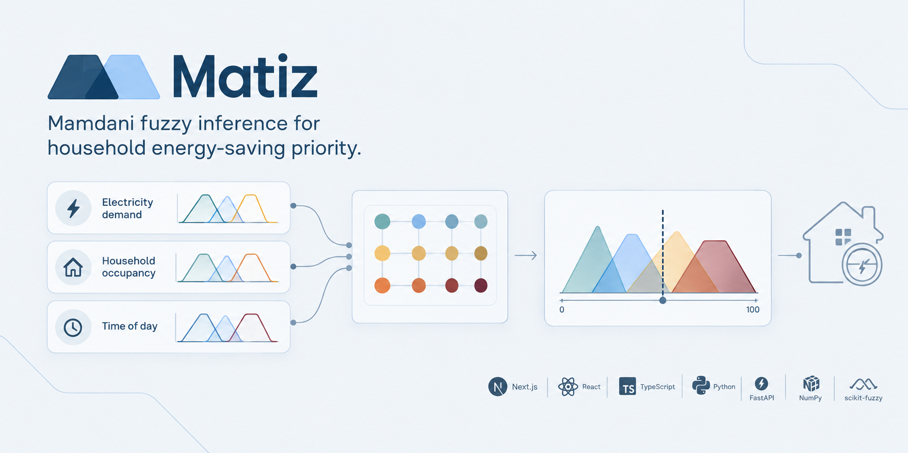

# Matiz — Fuzzy Energy-Saving Simulator



[](https://nextjs.org/)
[](https://react.dev/)
[](https://www.typescriptlang.org/)
[](https://tailwindcss.com/)
[](https://github.com/engiegarcia/fuzzy-system-backend)
[](LICENSE)

Web interface for a Mamdani fuzzy inference system that estimates the Energy-Saving Priority Index (IPA) for a household. The index ranges from 0 to 100 and is calculated from electricity demand, occupancy, and time of day.

The application consumes the [Python/FastAPI backend](https://github.com/engiegarcia/fuzzy-system-backend) and presents both the result and its reasoning: membership degrees, activated rules, output aggregation, and centroid.

## Features

- Interactive simulation with power, occupancy, and time-of-day inputs.
- IPA result, interpretation, and recommended action.
- Visual fuzzification of every input.
- Activated-rule table and output aggregation chart.
- Four predefined academic test cases.
- Parameter sweep to explore how a variable affects the IPA.
- Batch evaluation from CSV files.
- Full rule-base view.
- Light and dark themes.

## Tech stack

- Next.js 15
- React 19
- TypeScript
- Tailwind CSS
- TanStack Query
- Recharts
- React Hook Form and Zod

## Requirements

- Node.js 22 or later
- pnpm 11
- A running instance of the [fuzzy-system backend](https://github.com/engiegarcia/fuzzy-system-backend)

## Getting started

1. Install dependencies:

   ```bash
   pnpm install --frozen-lockfile
   ```

2. Create the local environment file:

   ```bash
   cp .env.local.example .env.local
   ```

3. Configure the backend URL in `.env.local`:

   ```env
   NEXT_PUBLIC_API_URL=http://localhost:8000
   ```

4. Start the development server:

   ```bash
   pnpm dev
   ```

Open [http://localhost:3000](http://localhost:3000) in your browser.

## Backend configuration

The frontend requires the [fuzzy-system backend](https://github.com/engiegarcia/fuzzy-system-backend) to be available through HTTP. Follow its setup instructions before starting this application. The `NEXT_PUBLIC_API_URL` variable must contain its base URL without a trailing slash.

| Variable | Default | Description |
| --- | --- | --- |
| `NEXT_PUBLIC_API_URL` | `http://localhost:8000` | Base URL of the FastAPI backend. |
| `E2E_REAL_BACKEND` | Not set | Enables end-to-end tests against a real backend when set to `1`. |

When deploying the frontend, set `NEXT_PUBLIC_API_URL` to the deployed backend URL and add the frontend domain to the backend CORS allowlist.

## Available scripts

| Command | Description |
| --- | --- |
| `pnpm dev` | Starts the development server. |
| `pnpm build` | Creates a production build. |
| `pnpm start` | Starts the production server. |
| `pnpm typecheck` | Runs TypeScript validation. |
| `pnpm lint` | Runs ESLint. |
| `pnpm test` | Runs unit and component tests with Vitest. |
| `pnpm e2e` | Runs end-to-end tests with Playwright. |
| `pnpm format` | Formats source files with Prettier. |

To install the browser required by Playwright:

```bash
pnpm exec playwright install chromium
```

## Project structure

```text
app/          Application routes and layouts
components/   Reusable UI and feature components
hooks/        Data-fetching and UI hooks
lib/          API client, validation, formatting, CSV, and helpers
types/        TypeScript contracts for the backend API
public/       CSV templates and sample cases
tests/        Unit and component tests
e2e/          End-to-end tests
```

## Application views

| Route | Description |
| --- | --- |
| `/` | Main simulator with IPA result and inference details. |
| `/explorar` | Parameter sweep for power, occupancy, or time. |
| `/lote` | CSV batch evaluation and result export. |
| `/reglas` | Complete fuzzy rule base and active-rule context. |
| `/acerca` | Summary of the fuzzy method and study limitations. |

## Input domain

| Input | Accepted range |
| --- | --- |
| Power demand | 0–3000 W |
| Occupancy | 0–6 people; fractional values are accepted |
| Time of day | 00:00–24:00; decimal and `HH:MM` formats are accepted |

The hour is circular: 24:00 and 00:00 represent the same time. Invalid values are reported to the user and are not sent for evaluation.

## Fuzzy inference flow

The frontend does not calculate the IPA. The backend remains the single source of truth for fuzzification, rule evaluation, aggregation, defuzzification, interpretation, and recommended actions.

For visualization only, the frontend reconstructs the aggregated output curve from the membership curves and the rule activations returned by the API. The displayed centroid always uses the IPA value returned by the backend.

## Testing

Run the standard verification suite before creating a release:

```bash
pnpm typecheck
pnpm test
pnpm build
```

The end-to-end suite uses mocked backend responses by default. To test against a running backend, set `E2E_REAL_BACKEND=1` before executing `pnpm e2e`.

## Academic context

Developed for the *Sistemas Inteligentes* course at Universidad Nacional Mayor de San Marcos (UNMSM).

## License

Distributed under the [MIT License](LICENSE).
