<div align="center">


**Universidad Nacional Mayor de San Marcos**

***Universidad del Perú. Decana de América***

Facultad de Ingeniería de Sistemas e Informática

Escuela Profesional de Ingeniería de Sistemas

**Sistema experto para la selección de fuentes de energía renovable en comunidades rurales no conectadas a la red eléctrica**

**ASIGNATURA:**

Sistemas Inteligentes

**Lima - Perú**

**2026**

</div>

---

**Índice general**

- [1. Introducción](#1-introducción)
  - [1.1 Definición del problema](#11-definición-del-problema)
  - [1.2 Objetivo del trabajo](#12-objetivo-del-trabajo)
  - [1.3 Importancia del tema](#13-importancia-del-tema)
- [2. Definición de variables](#2-definición-de-variables)
  - [2.1 Variables de entrada](#21-variables-de-entrada)
    - [2.1.1 Universo de discurso y etiquetas lingüísticas](#211-universo-de-discurso-y-etiquetas-lingüísticas)
    - [2.1.2 Funciones de membresía](#212-funciones-de-membresía)
  - [2.2 Variable de salida](#22-variable-de-salida)
    - [2.2.1 Universo de discurso y etiquetas lingüísticas](#221-universo-de-discurso-y-etiquetas-lingüísticas)
    - [2.2.2 Funciones de membresía](#222-funciones-de-membresía)
- [3. Definición de las reglas a usar](#3-definición-de-las-reglas-a-usar)
  - [3.1 Criterios para la definición de las reglas](#31-criterios-para-la-definición-de-las-reglas)
  - [3.2 Base de reglas difusas](#32-base-de-reglas-difusas)
  - [3.3 Auditoría lógica de la base](#33-auditoría-lógica-de-la-base)
  - [3.4 Proceso de activación con ejemplo numérico](#34-proceso-de-activación-con-ejemplo-numérico)
  - [3.5 Interpretación de la salida](#35-interpretación-de-la-salida)
- [4. Operadores usados](#4-operadores-usados)
  - [4.1 Fuzzificación](#41-fuzzificación)
  - [4.2 Intersección (AND)](#42-intersección-and)
  - [4.3 Implicación](#43-implicación)
  - [4.4 Agregación](#44-agregación)
  - [4.5 Defuzzificación](#45-defuzzificación)
  - [4.6 Justificación de Mamdani frente a Sugeno](#46-justificación-de-mamdani-frente-a-sugeno)
  - [4.7 Resumen de operadores y glosario de símbolos](#47-resumen-de-operadores-y-glosario-de-símbolos)
- [5. Desarrollo en Python](#5-desarrollo-en-python)
  - [5.1 Entorno y bibliotecas](#51-entorno-y-bibliotecas)
  - [5.2 Definición de las variables](#52-definición-de-las-variables)
  - [5.3 Funciones de membresía](#53-funciones-de-membresía)
  - [5.4 Base de reglas](#54-base-de-reglas)
  - [5.5 Sistema de control y simulación](#55-sistema-de-control-y-simulación)
    - [Verificación mediante un caso de simulación](#verificación-mediante-un-caso-de-simulación)
    - [Acceso mediante API](#acceso-mediante-api)
  - [5.6 Gráficas](#56-gráficas)
- [6. Corridas del programa](#6-corridas-del-programa)
  - [6.1 Corrida 1](#61-corrida-1)
    - [Fuzzificación](#fuzzificación)
    - [Reglas activadas](#reglas-activadas)
    - [Análisis del resultado](#análisis-del-resultado)
  - [6.2 Corrida 2](#62-corrida-2)
    - [Fuzzificación](#fuzzificación-1)
    - [Reglas activadas](#reglas-activadas-1)
    - [Análisis del resultado](#análisis-del-resultado-1)
  - [6.3 Corrida 3](#63-corrida-3)
    - [Fuzzificación](#fuzzificación-2)
    - [Reglas activadas](#reglas-activadas-2)
    - [Análisis del resultado](#análisis-del-resultado-2)
  - [6.4 Corrida 4](#64-corrida-4)
    - [Fuzzificación](#fuzzificación-3)
    - [Regla activada](#regla-activada)
    - [Análisis del resultado](#análisis-del-resultado-3)
  - [6.5 Análisis comparativo de las corridas](#65-análisis-comparativo-de-las-corridas)
- [7. Conclusiones](#7-conclusiones)
- [8. Referencias](#8-referencias)

**Índice de tablas**

- [Tabla 1. Variables de entrada y de salida, universos, etiquetas y fuente](#tabla-1)

- [Tabla 2. Anclajes de los parámetros: valor, dato oficial de respaldo y fuente](#tabla-2)

- [Tabla 3. Funciones de membresía de las variables de entrada](#tabla-3)

- [Tabla 4. Funciones de membresía del índice de prioridad de ahorro](#tabla-4)

- [Tabla 5. Criterios de las reglas: factor, efecto, rango y fuente](#tabla-5)

- [Tabla 6. Base de reglas difusas (36 reglas)](#tabla-6)

- [Tabla 7. Resultado de la auditoría lógica de la base de reglas](#tabla-7)

- [Tabla 8. Reglas activadas para 1900 W, 3 ocupantes y 12:00 h](#tabla-8)

- [Tabla 9. Interpretación del índice de prioridad de ahorro y acción sugerida](#tabla-9)

- [Tabla 10. Operadores utilizados en el sistema de inferencia Mamdani](#tabla-10)

- [Tabla 11. Glosario de símbolos](#tabla-11)

- [Tabla 12. Matriz de trazabilidad de las afirmaciones principales](#tabla-12)

- [Tabla 13. Bibliotecas principales del proyecto y su aplicación](#tabla-13)

- [Tabla 14. Salida de la base de reglas según consumo, personas y bloque horario](#tabla-14)

- [Tabla 15. Grados de pertenencia obtenidos para 1900 W, 3 personas y 12:00 h](#tabla-15)

- [Tabla 16. Reglas activadas para 1900 W, 3 personas y 12:00 h](#tabla-16)

- [Tabla 17. Endpoints principales de la API](#tabla-17)

- [Tabla 18. Resumen de las cuatro corridas del programa](#tabla-18)

- [Tabla 19. Datos y resultado de la corrida 1](#tabla-19)

- [Tabla 20. Grados de pertenencia de la corrida 1](#tabla-20)

- [Tabla 21. Reglas activadas en la corrida 1](#tabla-21)

- [Tabla 22. Datos y resultado de la corrida 2](#tabla-22)

- [Tabla 23. Grados de pertenencia de la corrida 2](#tabla-23)

- [Tabla 24. Reglas activadas en la corrida 2](#tabla-24)

- [Tabla 25. Datos y resultado de la corrida 3](#tabla-25)

- [Tabla 26. Grados de pertenencia de la corrida 3](#tabla-26)

- [Tabla 27. Reglas activadas en la corrida 3](#tabla-27)

- [Tabla 28. Datos y resultado de la corrida 4](#tabla-28)

- [Tabla 29. Grados de pertenencia de la corrida 4](#tabla-29)

- [Tabla 30. Regla activada en la corrida 4](#tabla-30)

- [Tabla 31. Comparación entre corridas](#tabla-31)

**Índice de figuras**

- [Figura 1. Funciones de pertenencia de la potencia eléctrica instantánea y del número de ocupantes](#figura-1)

- [Figura 2. Funciones de pertenencia del bloque horario con tratamiento circular](#figura-2)

- [Figura 3. Funciones de pertenencia del índice de prioridad de ahorro](#figura-3)

- [Figura 4. Agregación de las salidas activadas y centroide para 1900 W, 3 ocupantes y 12:00 h](#figura-4)

- [Figura 5. Flujo de procesamiento del sistema difuso, desde la solicitud hasta la respuesta](#figura-5)

- [Figura 5. Resultado de la corrida 1 en la interfaz del sistema: 300 W, 4 ocupantes y 12:00 h](#figura-5)

- [Figura 6. Agregación del conjunto «Muy bajo» y centroide de 11,59 puntos para la corrida 1](#figura-6)

- [Figura 7. Resultado de la corrida 2 en la interfaz del sistema: 1900 W, 3 ocupantes y 12:00 h](#figura-7)

- [Figura 8. Agregación de los conjuntos Bajo, Medio y Alto y centroide de 46,72 puntos para la corrida 2](#figura-8)

- [Figura 9. Resultado de la corrida 3 en la interfaz del sistema: 1900 W, 3 ocupantes y 19:00 h](#figura-9)

- [Figura 10. Agregación de los conjuntos Medio y Muy alto y centroide de 59,61 puntos para la corrida 3](#figura-10)

- [Figura 11. Resultado de la corrida 4 en la interfaz del sistema: 2800 W, 1 ocupante y 02:00 h](#figura-11)

- [Figura 12. Agregación del conjunto «Muy alto» y centroide de 90,71 puntos para la corrida 4](#figura-12)

# 1. Introducción

## 1.1 Definición del problema

El consumo eléctrico de una vivienda varía con la presencia y las actividades de sus ocupantes, el horario y los equipos en funcionamiento (Kavousian et al., 2013; Richardson et al., 2010). Un mismo nivel de potencia puede ser razonable en una situación y requerir revisión en otra; por ello, un sistema difuso permite formular una prioridad gradual sin imponer una frontera única a todos los hogares.

Los sistemas de gestión energética residencial (*Home Energy Management Systems*, HEMS) supervisan, programan y controlan las cargas del hogar. Shareef et al. (2018) describen para estos sistemas estrategias de respuesta a la demanda, desplazamiento y reducción de cargas, y técnicas de inteligencia artificial como la lógica difusa. Zhou et al. (2016) describen sus configuraciones y estrategias de programación de cargas. En ambos casos, decidir cuándo y cuánto reducir el consumo es un problema central.

La lógica difusa representa variables mediante categorías lingüísticas y grados de pertenencia, y permite tratar situaciones sin fronteras nítidas. Fue introducida por Zadeh (1965) y aplicada al control con reglas lingüísticas por Mamdani y Assilian (1975). Un sistema de tipo Mamdani admite reglas como «si la potencia es alta y el bloque horario es Punta, entonces la prioridad de ahorro es alta», y produce una respuesta gradual ante variaciones pequeñas de las entradas.

A diferencia del modelo de Takagi y Sugeno (1985), cuyo consecuente es una función de las entradas, el enfoque Mamdani conserva consecuentes lingüísticos, lo que favorece la interpretabilidad de reglas y salida (Jang et al., 1997; Ross, 2010). Esta propiedad es conveniente cuando la recomendación debe ser comprensible para el usuario de la vivienda.

En el ámbito energético residencial existen aplicaciones del enfoque Mamdani. Kontogiannis et al. (2021) desarrollaron un sistema de control difuso para recomendar valores mínimos de consumo en edificios residenciales a partir de datos ambientales e históricos. Javaid et al. (2017) analizaron sistemas Mamdani y Takagi-Sugeno para un termostato adaptativo con temperatura exterior, ocupación y precio. Bissey et al. (2017) y Ciabattoni et al. (2013) muestran que las reglas difusas pueden apoyar la gestión y el modelado del consumo residencial cuando sus variables y criterios se explicitan.

El modelo se limita a tres variables de entrada: potencia eléctrica instantánea, número de ocupantes y bloque horario. Se excluyen deliberadamente las condiciones ambientales y el inventario de equipos, con el fin de mantener una base de reglas completa y verificable. Esta simplificación se retoma como limitación en la sección 3.5.

## 1.2 Objetivo del trabajo

***Objetivo general***

Diseñar un sistema de inferencia difusa de tipo Mamdani que calcule un índice de prioridad de ahorro eléctrico (0–100 puntos) para una vivienda, a partir de la potencia eléctrica instantánea, el número de ocupantes y el bloque horario.

***Objetivos específicos***

- Definir los universos de discurso, las etiquetas lingüísticas y las funciones de pertenencia de las variables de entrada y salida, con anclaje en documentos oficiales.

- Construir una base de reglas completa de 36 reglas, con efectos respaldados por fuentes verificables y consecuentes obtenidos mediante una única función ordinal trazable.

- Verificar mediante script la cobertura, la consistencia y las propiedades de monotonía de la base de reglas.

- Formalizar los operadores de la inferencia Mamdani (mínimo, mínimo, máximo y centroide) y calcular un ejemplo numérico completo.

- Relacionar el diseño con los Objetivos de Desarrollo Sostenible (ODS): el ODS 7 (Energía asequible y no contaminante), el ODS 12 (Producción y consumo responsables) y, de forma indirecta, el ODS 13 (Acción por el clima).

La implementación en Python y las corridas se documentan en las secciones 5 y 6, que permanecen pendientes.

## 1.3 Importancia del tema

Gestionar la electricidad con criterios de ahorro reduce el consumo innecesario y orienta hábitos responsables en los hogares (Shareef et al., 2018). La lógica difusa es pertinente porque opera con información imprecisa y límites graduales (Zadeh, 1965; Zimmermann, 2001), y evita los cambios bruscos de decisión que producen los umbrales fijos.

El diseño integra conceptos de inteligencia artificial, sistemas de control y eficiencia energética. La propuesta contempla una simulación en Python y, como línea futura, su conexión con sensores y un microcontrolador.

El diseño se vincula con los Objetivos de Desarrollo Sostenible de la Agenda 2030 (Naciones Unidas, 2015): con el ODS 7, al orientar un uso más eficiente de la energía; con el ODS 12, al señalar el consumo evitable; y, de forma indirecta, con el ODS 13, porque una mayor eficiencia puede reducir las emisiones asociadas a la generación eléctrica.

# 2. Definición de variables

## 2.1 Variables de entrada

El sistema emplea tres variables de entrada (Tabla 1). La potencia eléctrica instantánea se expresa en vatios (W) y es una magnitud de demanda en un instante. La energía acumulada se expresa en vatios-hora (Wh) o kilovatios-hora (kWh) y se obtiene integrando la potencia en el tiempo:

$$
E = \int_{t_{1}}^{t_{2}}{P(t)dt} \tag{1}
$$

donde *E* es la energía (Wh), *P*(*t*) la potencia instantánea (W) y *t*₁, *t*₂ los límites del intervalo de integración (h). La variable de entrada del sistema es *P*, no *E*.

Los universos y cortes se establecen a partir de tres fuentes verificables: la demanda mínima prevista por el Código Nacional de Electricidad (CNE), las potencias referenciales publicadas por Osinergmin y los grupos de tamaño de hogar del Censo 2017. El solapamiento entre conjuntos se define de forma explícita para asegurar continuidad. La Tabla 2 presenta los anclajes y la Tabla 3 los parámetros resultantes (Instituto Nacional de Estadística e Informática \[INEI\], 2018; Ministerio de Energía y Minas \[MINEM\], 2006; Organismo Supervisor de la Inversión en Energía y Minería \[Osinergmin\], s. f.).

### 2.1.1 Universo de discurso y etiquetas lingüísticas

**Potencia eléctrica instantánea.** Se adopta el universo de 0 a 5000 W para el caso de una vivienda de más de 90 m² y hasta 150 m² sin información específica de cargas. La Regla 050-110 del Código Nacional de Electricidad establece que, en esas condiciones, la demanda máxima total prevista no debe ser inferior a 5000 W (MINEM, 2006). Este valor delimita el caso de estudio; no constituye un máximo físico aplicable a cualquier vivienda. Los anclajes de 500, 1500 y 3500 W corresponden, respectivamente, a las potencias referenciales de una lavadora, una terma y una ducha eléctrica publicadas por Osinergmin (s. f.); no se presentan como límites universales de los artefactos.

**Número de ocupantes.** El universo operativo es de 0 a 8 personas e incluye cuatro etiquetas: Sin ocupantes, Pocas, Moderadas y Muchas. El cero distingue la vivienda sin presencia activa; los grupos 1, 2, 3–4, 5–6 y 7 o más provienen del Censo 2017. A nivel nacional, el 39,6 % de los hogares tenía 3–4 miembros, el 20,1 % tenía 5–6 y el 5,7 % tenía 7 o más (INEI, 2018, pp. 375–376). El valor 8 cierra únicamente el dominio computacional del caso de estudio y no representa un máximo poblacional.

**Bloque horario.** El universo es circular, de 0 a 24 h. Se emplean Base (23:00–08:00), Media (08:00–18:00) y Punta (18:00–23:00). Punta está definida en el numeral 4.9 de la Resolución N.° 206-2013-OS/CD, y Base y Media fueron incorporadas por la Resolución N.° 116-2023-OS/CD (Osinergmin, 2013, 2023).

**Validación de entradas.** La implementación deberá aceptar únicamente 0 ≤ *P* ≤ 5000 W y 0 ≤ *N* ≤ 8. Una lectura fuera de esos intervalos se marcará como fuera del dominio y no se recortará silenciosamente al límite. La hora se normalizará módulo 24, de modo que 24:00 equivalga a 00:00. Si la vivienda no pertenece al intervalo de más de 90 m² y hasta 150 m² o si se dispone de información específica de sus cargas, el universo de potencia y sus funciones de pertenencia deberán recalibrarse conforme al caso (MINEM, 2006).

<a id="tabla-1"></a>
**Tabla 1**  
*Variables de entrada y de salida, universos, etiquetas y fuente*

| **Variable**                        | **Universo**      | **Etiquetas**                           | **Fuente del universo**                                                                                                          |
|-------------------------------------|-------------------|-----------------------------------------|----------------------------------------------------------------------------------------------------------------------------------|
| Potencia eléctrica instantánea (W)  | 0–5000 W          | Baja, Media, Alta                       | CNE: 5000 W para el caso de vivienda \>90–150 m² sin cargas específicas; anclajes de artefactos (MINEM, 2006; Osinergmin, s. f.) |
| Número de ocupantes                 | 0–8 personas      | Sin ocupantes, Pocas, Moderadas, Muchas | Grupos de tamaño de hogar del Censo 2017 (INEI, 2018)                                                                            |
| Bloque horario (h)                  | 0–24 h (circular) | Base, Media, Punta                      | Norma de Opciones Tarifarias (Osinergmin, 2013, 2023)                                                                            |
| Índice de prioridad de ahorro (IPA) | 0–100 puntos      | Muy bajo, Bajo, Medio, Alto, Muy alto   | Cinco bandas ordinales iguales de 20 puntos                                                                                      |

*Nota.* Elaboración propia a partir de las fuentes indicadas en la última columna.

<a id="tabla-2"></a>
**Tabla 2**  
*Anclajes de los parámetros: valor, dato oficial de respaldo y fuente*

| **Parámetro**                       | **Valor**               | **Dato de respaldo**                                                                                    | **Fuente**                      |
|-------------------------------------|-------------------------|---------------------------------------------------------------------------------------------------------|---------------------------------|
| Límite superior del caso de estudio | 5000 W                  | Demanda máxima total prevista no inferior a 5000 W para vivienda \>90–150 m² sin información específica | MINEM (2006), Regla 050-110     |
| Anclajes de potencia                | 500, 1500 y 3500 W      | Lavadora, terma y ducha eléctrica                                                                       | Osinergmin (s. f.), p. 1        |
| Grupos de ocupación                 | 1; 2; 3–4; 5–6; 7 o más | Distribución nacional del tamaño de los hogares                                                         | INEI (2018), pp. 375–376        |
| Frontera Base–Media                 | 08:00 h                 | Base: 23:00–08:00; Media: 08:00–18:00                                                                   | Osinergmin (2023), numeral 4.9  |
| Frontera Media–Punta                | 18:00 h                 | Punta: 18:00–23:00                                                                                      | Osinergmin (2013), numeral 4.9  |
| Frontera Punta–Base                 | 23:00 h                 | Inicio de Base                                                                                          | Osinergmin (2023), numeral 4.9  |
| Transición horaria                  | 1 h                     | Solapamiento que concluye en cada frontera (7–8, 17–18 y 22–23 h)                                       | Definición operacional; Tabla 3 |
| Efecto tarifario horario            | Base/Media \< Punta     | Hasta −17 % en Base y Media; +8 % en Punta                                                              | Osinergmin (2024)               |

*Nota.* Elaboración propia. Los anclajes y fronteras se vinculan con su fuente y localización.

### 2.1.2 Funciones de membresía

Se emplean funciones triangulares y trapezoidales por su sencillez de interpretación y ajuste (Jang et al., 1997; Ross, 2010). La función triangular de vértices a ≤ b ≤ c se define en la ecuación (2) y la trapezoidal de vértices a ≤ b ≤ c ≤ d en la ecuación (3). La Tabla 3 resume los parámetros de las tres variables de entrada.

$$
\mu_{tri}(x;a,b,c) = \begin{cases}
0,\ \ x < a\ \text{ o }\ x > c \\
\frac{x - a}{b - a},\ \ a \leq x < b \\
1,\ \ x = b \\
\frac{c - x}{c - b},\ \ b < x \leq c
\end{cases} \tag{2}
$$

$$
\mu_{trap}(x;a,b,c,d) = \begin{cases}
0,\ \ x < a\ \text{ o }\ x > d \\
\frac{x - a}{b - a},\ \ a \leq x < b \\
1,\ \ b \leq x \leq c \\
\frac{d - x}{d - c},\ \ c < x \leq d
\end{cases} \tag{3}
$$

En las ecuaciones (2) y (3), la rama de pendiente creciente se evalúa solo si a \< b y la de pendiente decreciente solo si b \< c (triangular) o c \< d (trapezoidal). Los casos degenerados a = b o c = d no dividen por cero: el valor en la meseta coincide con 1. En los vértices, μ(a) = μ(d) = 0 salvo degeneración, y μ(b) = μ(c) = 1.

<a id="tabla-3"></a>
**Tabla 3**  
*Funciones de membresía de las variables de entrada*

| **Variable**       | **Etiqueta**  | **Tipo**             | **Parámetros**                          |
|--------------------|---------------|----------------------|-----------------------------------------|
| Potencia (W)       | Baja          | Trapezoidal          | \[0, 0, 500, 1500\]                     |
|                    | Media         | Triangular           | \[500, 1500, 3500\]                     |
|                    | Alta          | Trapezoidal          | \[1500, 3500, 5000, 5000\]              |
| Ocupantes          | Sin ocupantes | Trapezoidal          | \[0, 0, 0, 1\]                          |
|                    | Pocas         | Trapezoidal          | \[0, 1, 2, 3\]                          |
|                    | Moderadas     | Trapezoidal          | \[2, 3, 4, 5\]                          |
|                    | Muchas        | Trapezoidal          | \[4, 5, 8, 8\]                          |
| Bloque horario (h) | Base          | Trapezoidal circular | máx(\[0, 0, 7, 8\]; \[22, 23, 24, 24\]) |
|                    | Media         | Trapezoidal          | \[7, 8, 17, 18\]                        |
|                    | Punta         | Trapezoidal          | \[17, 18, 22, 23\]                      |

*Nota.* Los anclajes de potencia proceden de MINEM (2006) y Osinergmin (s. f.); los grupos de ocupación, de INEI (2018); y las fronteras horarias, de Osinergmin (2013, 2023). El solapamiento de una hora, el cierre operativo de ocupación en 8 y la interpolación entre anclajes son definiciones computacionales para asegurar continuidad y cobertura; no se presentan como estimaciones poblacionales ni como efectos empíricos.

**Circularidad de la hora.** La hora es una variable cíclica: tras las 24:00 se retorna a las 00:00. El bloque Base cruza la medianoche y se define como el máximo de dos trapecios (ecuación 4). Con esta construcción, μ(0) = μ(24) = 1, cada instante activa como máximo dos bloques y la cobertura no presenta discontinuidades. Las Figuras 1 y 2 muestran, respectivamente, las particiones de potencia y ocupación y la partición horaria.

$$
\mu_{Base}(h) = \text{máx}\left( \mu_{trap}(h;0,0,7,8)\ ;\ \mu_{trap}(h;22,23,24,24) \right) \tag{4}
$$

<a id="figura-1"></a>
**Figura 1**  
*Funciones de pertenencia de la potencia eléctrica instantánea y del número de ocupantes*

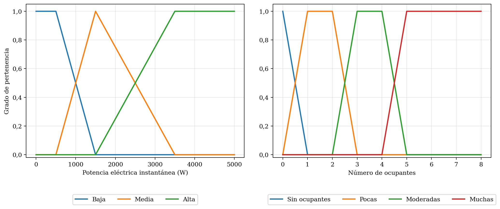

*Nota.* Elaboración propia, generada con los parámetros de la Tabla 3.

<a id="figura-2"></a>
**Figura 2**  
*Funciones de pertenencia del bloque horario con tratamiento circular*

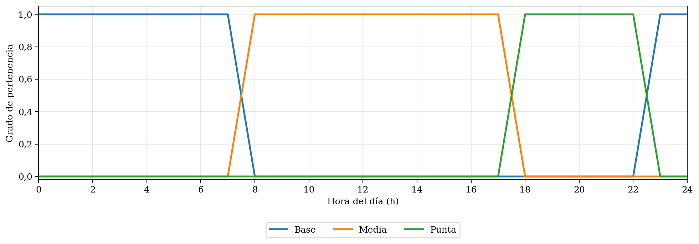

*Nota.* Elaboración propia. El bloque Base se define con dos trapecios unidos mediante el operador máximo.

## 2.2 Variable de salida

La salida es el **índice de prioridad de ahorro** (IPA), una puntuación de 0 a 100 puntos que indica la urgencia relativa de aplicar medidas de reducción de carga. No es un porcentaje de reducción del consumo ni una cantidad de energía. En el texto, «índice» designa la variable, «puntos» su unidad y «nivel» cada etiqueta lingüística.

### 2.2.1 Universo de discurso y etiquetas lingüísticas

El universo es \[0, 100\] puntos y se divide en cinco bandas iguales de 20 puntos: Muy bajo, Bajo, Medio, Alto y Muy alto. Los centros se sitúan en 10, 30, 50, 70 y 90 puntos; las intersecciones entre etiquetas contiguas coinciden con los límites 20, 40, 60 y 80 utilizados en la interpretación. Esta construcción convierte la escala ordinal en una partición reproducible.

### 2.2.2 Funciones de membresía

La Tabla 4 define la partición de salida y la Figura 3 representa gráficamente sus cinco etiquetas.

<a id="tabla-4"></a>
**Tabla 4**  
*Funciones de membresía del índice de prioridad de ahorro*

| **Etiqueta** | **Tipo**    | **Parámetros (puntos)** | **Centroide (puntos)** |
|--------------|-------------|-------------------------|------------------------|
| Muy bajo     | Trapezoidal | \[0, 0, 10, 30\]        | 10,83                  |
| Bajo         | Triangular  | \[10, 30, 50\]          | 30,00                  |
| Medio        | Triangular  | \[30, 50, 70\]          | 50,00                  |
| Alto         | Triangular  | \[50, 70, 90\]          | 70,00                  |
| Muy alto     | Trapezoidal | \[70, 90, 100, 100\]    | 89,17                  |

*Nota.* Elaboración propia. Los centroides se calcularon con 10 001 puntos; los cruces entre etiquetas corresponden a 20, 40, 60 y 80 puntos.

<a id="figura-3"></a>
**Figura 3**  
*Funciones de pertenencia del índice de prioridad de ahorro*

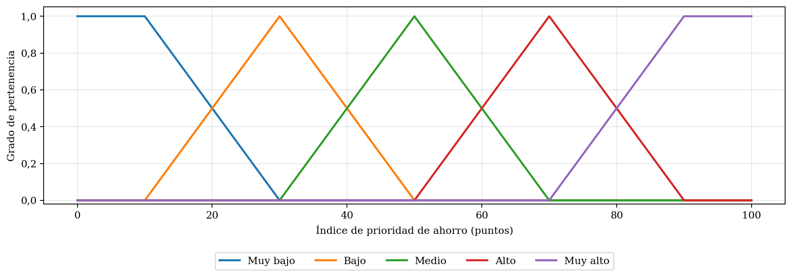

*Nota.* Elaboración propia, generada con los parámetros de la Tabla 4.

Los centroides de las etiquetas extremas (10,83 y 89,17 puntos) acotan el rango práctico de una salida producida exclusivamente por una de esas etiquetas.

# 3. Definición de las reglas a usar

## 3.1 Criterios para la definición de las reglas

Las reglas tienen la forma «SI-ENTONCES» (Mamdani & Assilian, 1975) y relacionan los tres antecedentes con una etiqueta del IPA. Keshtkar et al. (2015) emplearon demanda de carga, precio de la electricidad y presencia del ocupante para determinar reducción de carga residencial; Ain et al. (2018) describieron una generación combinatoria de reglas para un sistema residencial de gestión energética. Estos antecedentes respaldan la selección conjunta de potencia, bloque tarifario y presencia. Se evaluaron dos particiones: (a) 3 potencias × 3 ocupaciones × 4 franjas = 36 y (b) 3 potencias × 4 ocupaciones × 3 bloques = 36. Se adoptó (b), porque los tres bloques cuentan con definición oficial en la Resolución N.° 116-2023-OS/CD, mientras que una partición en cuatro franjas requeriría límites horarios sin respaldo normativo. La etiqueta Sin ocupantes cubre la vivienda vacía. La base resultante tiene 36 antecedentes distintos y no repite combinaciones.

Cada consecuente se obtiene del puntaje *S* = *r*<sub>P</sub> + *r*<sub>O</sub> + *r*<sub>H</sub>, limitado al intervalo \[0, 4\]. Los valores 0, 1, 2, 3 y 4 corresponden a Muy bajo, Bajo, Medio, Alto y Muy alto. Para evitar colisiones con los vértices a, b, c y d, *r*<sub>P</sub> identifica el rango de potencia; *r*<sub>O</sub>, el ajuste por ausencia de ocupantes; y *r*<sub>H</sub>, el ajuste del bloque horario. La Tabla 5 documenta el sentido, la magnitud ordinal y la fuente de cada componente.

<a id="tabla-5"></a>
**Tabla 5**  
*Criterios de las reglas: factor, efecto, rango y fuente*

| **Factor**          | **Efecto sobre el IPA**                                                                     | **Rango ordinal**                                                        | **Respaldo**                                                                                                                                                                                                                                                                                          |
|---------------------|---------------------------------------------------------------------------------------------|--------------------------------------------------------------------------|-------------------------------------------------------------------------------------------------------------------------------------------------------------------------------------------------------------------------------------------------------------------------------------------------------|
| Potencia            | Una etiqueta de potencia mayor incrementa la prioridad                                      | *r*<sub>P</sub>: Baja = 0; Media = 1; Alta = 2                           | Reducción de picos y gestión de carga (Bissey et al., 2017; Keshtkar et al., 2015); anclajes del dominio (MINEM, 2006; Osinergmin, s. f.)                                                                                                                                                             |
| Ocupación           | Solo la ausencia incrementa la prioridad; las categorías con presencia no se ordenan        | *r*<sub>O</sub>: Sin ocupantes = 1; Pocas = 0; Moderadas = 0; Muchas = 0 | Ausencia/presencia en control residencial (Ain et al., 2018; Keshtkar et al., 2015); consumo en espera reducible (International Energy Agency \[IEA\], 2001; Şahin & Aydinalp Koksal, 2014); sin gradiente universal entre categorías con presencia (Kavousian et al., 2013; Richardson et al., 2010) |
| Bloque Base         | Mismo rango que Media                                                                       | *r*<sub>H</sub> = 0                                                      | Bloque fuera de punta y reducción tarifaria informada (Osinergmin, 2023, 2024)                                                                                                                                                                                                                        |
| Bloque Media        | Mismo rango que Base                                                                        | *r*<sub>H</sub> = 0                                                      | Bloque fuera de punta y reducción tarifaria informada (Osinergmin, 2023, 2024)                                                                                                                                                                                                                        |
| Bloque Punta        | Incrementa la prioridad en un nivel                                                         | *r*<sub>H</sub> = 1                                                      | Periodo y recargo de Punta (Osinergmin, 2013, 2023, 2024)                                                                                                                                                                                                                                             |
| Conversión a salida | *S* = *r*<sub>P</sub> + *r*<sub>O</sub> + *r*<sub>H</sub> se traduce a una etiqueta del IPA | 0 Muy bajo; 1 Bajo; 2 Medio; 3 Alto; 4 Muy alto                          | Reglas lingüísticas y consecuentes Mamdani (Mamdani & Assilian, 1975; Ross, 2010); escala ordinal definida en la sección 2.2                                                                                                                                                                          |

*Nota.* Elaboración propia. Cada consecuente se obtiene mecánicamente de *S* = *r*<sub>P</sub> + *r*<sub>O</sub> + *r*<sub>H</sub>; no se asignaron consecuentes independientes. El valor de cada componente y su fuente se documentan en la tabla.

La dirección de los tres componentes se fijó con evidencia verificable. Una potencia medida más alta eleva la prioridad porque la gestión residencial busca reducir picos y reorganizar cargas; este sentido coincide con los sistemas de gestión descritos por Bissey et al. (2017) y Keshtkar et al. (2015). Para la ocupación no se adopta un gradiente que reduzca sucesivamente la prioridad de Pocas a Muchas personas: Kavousian et al. (2013) y Richardson et al. (2010) muestran que la presencia, las actividades y el número de ocupantes influyen en la demanda, pero no proporcionan un coeficiente ordinal universal que justifique esa secuencia para este IPA. Por ello, Pocas, Moderadas y Muchas reciben *r*<sub>O</sub> = 0. Solo Sin ocupantes recibe *r*<sub>O</sub> = 1: la literatura de control residencial distingue entre ausencia y presencia (Ain et al., 2018; Keshtkar et al., 2015), y los equipos pueden mantener un consumo en espera reducible cuando no prestan su función principal (IEA, 2001; Şahin & Aydinalp Koksal, 2014). Finalmente, la opción BT5-I establece precios diferenciados y Osinergmin informa una reducción de hasta 17 % en Base y Media y un incremento de 8 % en Punta; por ello, Base y Media reciben *r*<sub>H</sub> = 0 y Punta *r*<sub>H</sub> = 1 (Osinergmin, 2023, 2024). Los valores 0, 1 y 2 son rangos de una escala ordinal definida para el controlador, no coeficientes empíricos de consumo; la misma escala se aplica sin excepciones a las 36 reglas.

## 3.2 Base de reglas difusas

La Tabla 6 presenta las 36 reglas ordenadas por potencia, ocupación y bloque. La columna de cálculo expone el valor de cada componente antes de obtener el consecuente. La distribución de consecuentes es: Muy bajo (6), Bajo (11), Medio (12), Alto (6), Muy alto (1).

<a id="tabla-6"></a>
**Tabla 6**  
*Base de reglas difusas (36 reglas)*

| **N.°** | **Potencia** | **Ocupantes** | **Bloque** | ***r*<sub>P</sub> + *r*<sub>O</sub> + *r*<sub>H</sub> = *S*** | **IPA**  |
|---------|--------------|---------------|------------|---------------------------------------------------------------|----------|
| R1      | Baja         | Sin ocupantes | Base       | 0 + 1 + 0 = 1                                                 | Bajo     |
| R2      | Baja         | Sin ocupantes | Media      | 0 + 1 + 0 = 1                                                 | Bajo     |
| R3      | Baja         | Sin ocupantes | Punta      | 0 + 1 + 1 = 2                                                 | Medio    |
| R4      | Baja         | Pocas         | Base       | 0 + 0 + 0 = 0                                                 | Muy bajo |
| R5      | Baja         | Pocas         | Media      | 0 + 0 + 0 = 0                                                 | Muy bajo |
| R6      | Baja         | Pocas         | Punta      | 0 + 0 + 1 = 1                                                 | Bajo     |
| R7      | Baja         | Moderadas     | Base       | 0 + 0 + 0 = 0                                                 | Muy bajo |
| R8      | Baja         | Moderadas     | Media      | 0 + 0 + 0 = 0                                                 | Muy bajo |
| R9      | Baja         | Moderadas     | Punta      | 0 + 0 + 1 = 1                                                 | Bajo     |
| R10     | Baja         | Muchas        | Base       | 0 + 0 + 0 = 0                                                 | Muy bajo |
| R11     | Baja         | Muchas        | Media      | 0 + 0 + 0 = 0                                                 | Muy bajo |
| R12     | Baja         | Muchas        | Punta      | 0 + 0 + 1 = 1                                                 | Bajo     |
| R13     | Media        | Sin ocupantes | Base       | 1 + 1 + 0 = 2                                                 | Medio    |
| R14     | Media        | Sin ocupantes | Media      | 1 + 1 + 0 = 2                                                 | Medio    |
| R15     | Media        | Sin ocupantes | Punta      | 1 + 1 + 1 = 3                                                 | Alto     |
| R16     | Media        | Pocas         | Base       | 1 + 0 + 0 = 1                                                 | Bajo     |
| R17     | Media        | Pocas         | Media      | 1 + 0 + 0 = 1                                                 | Bajo     |
| R18     | Media        | Pocas         | Punta      | 1 + 0 + 1 = 2                                                 | Medio    |
| R19     | Media        | Moderadas     | Base       | 1 + 0 + 0 = 1                                                 | Bajo     |
| R20     | Media        | Moderadas     | Media      | 1 + 0 + 0 = 1                                                 | Bajo     |
| R21     | Media        | Moderadas     | Punta      | 1 + 0 + 1 = 2                                                 | Medio    |
| R22     | Media        | Muchas        | Base       | 1 + 0 + 0 = 1                                                 | Bajo     |
| R23     | Media        | Muchas        | Media      | 1 + 0 + 0 = 1                                                 | Bajo     |
| R24     | Media        | Muchas        | Punta      | 1 + 0 + 1 = 2                                                 | Medio    |
| R25     | Alta         | Sin ocupantes | Base       | 2 + 1 + 0 = 3                                                 | Alto     |
| R26     | Alta         | Sin ocupantes | Media      | 2 + 1 + 0 = 3                                                 | Alto     |
| R27     | Alta         | Sin ocupantes | Punta      | 2 + 1 + 1 = 4                                                 | Muy alto |
| R28     | Alta         | Pocas         | Base       | 2 + 0 + 0 = 2                                                 | Medio    |
| R29     | Alta         | Pocas         | Media      | 2 + 0 + 0 = 2                                                 | Medio    |
| R30     | Alta         | Pocas         | Punta      | 2 + 0 + 1 = 3                                                 | Alto     |
| R31     | Alta         | Moderadas     | Base       | 2 + 0 + 0 = 2                                                 | Medio    |
| R32     | Alta         | Moderadas     | Media      | 2 + 0 + 0 = 2                                                 | Medio    |
| R33     | Alta         | Moderadas     | Punta      | 2 + 0 + 1 = 3                                                 | Alto     |
| R34     | Alta         | Muchas        | Base       | 2 + 0 + 0 = 2                                                 | Medio    |
| R35     | Alta         | Muchas        | Media      | 2 + 0 + 0 = 2                                                 | Medio    |
| R36     | Alta         | Muchas        | Punta      | 2 + 0 + 1 = 3                                                 | Alto     |

*Nota.* Elaboración propia. Cada fila aplica la misma política documentada: *r*<sub>P</sub> = 0, 1 y 2 representan potencia Baja, Media y Alta (Bissey et al., 2017; Keshtkar et al., 2015; MINEM, 2006; Osinergmin, s. f.); *r*<sub>O</sub> = 1 representa Sin ocupantes y *r*<sub>O</sub> = 0, las categorías con presencia (Ain et al., 2018; IEA, 2001; Keshtkar et al., 2015; Şahin & Aydinalp Koksal, 2014); *r*<sub>H</sub> = 1 representa Punta y *r*<sub>H</sub> = 0, Base o Media (Osinergmin, 2023, 2024). El consecuente se obtiene de *S* = *r*<sub>P</sub> + *r*<sub>O</sub> + *r*<sub>H</sub> y de la conversión 0–4 de la Tabla 5 (Mamdani & Assilian, 1975; Ross, 2010).

## 3.3 Auditoría lógica de la base

Se ejecutó un script reproducible en Python con NumPy (Harris et al., 2020). La base se comprobó exhaustivamente sobre sus 36 antecedentes; la cobertura de las funciones se evaluó en mallas de 1 W para potencia y 0,01 unidades para ocupación y hora. En todos los universos existe al menos una pertenencia positiva y el mínimo de la mayor pertenencia es 0,5000.

<a id="tabla-7"></a>
**Tabla 7**  
*Resultado de la auditoría lógica de la base de reglas*

| **Propiedad**                     | **Criterio**                                                                                                     | **Resultado** |
|-----------------------------------|------------------------------------------------------------------------------------------------------------------|---------------|
| Cobertura                         | 36 antecedentes distintos (3 × 4 × 3) y pertenencia positiva en todos los universos                              | Cumple        |
| Consistencia                      | Ningún antecedente tiene dos consecuentes                                                                        | Cumple        |
| Monotonía respecto de la potencia | A igual ocupación y bloque, la salida no disminuye al aumentar la potencia                                       | Cumple        |
| Efecto respaldado de la ocupación | Sin ocupantes añade un nivel; Pocas, Moderadas y Muchas conservan el mismo consecuente a igual potencia y bloque | Cumple        |
| Efecto de Punta                   | A igual potencia y ocupación, Punta no produce una salida menor que Base o Media                                 | Cumple        |

*Nota.* Elaboración propia. Verificación determinista con los parámetros de las Tablas 3–5. La auditoría comprueba cobertura, unicidad, monotonía con la potencia, neutralidad entre categorías con presencia, incremento por vivienda desocupada y efecto no decreciente de Punta.

## 3.4 Proceso de activación con ejemplo numérico

Cada regla *i* calcula su grado de activación con el operador mínimo sobre sus tres antecedentes (ecuación 5, sección 4.2). El conjunto difuso de salida se recorta a ese nivel (ecuación 6) y las salidas de todas las reglas se combinan con el operador máximo (ecuación 7). El resultado se defuzzifica por centroide (ecuaciones 8 y 9).

**Ejemplo numérico.** Se evalúa *P* = 1900 W, 3 ocupantes y las 12:00 h.

***Paso 1. Fuzzificación.*** Potencia: Baja = 0; Media = 0,8000; Alta = 0,2000. Ocupantes: Moderadas = 1,0000; las demás etiquetas, 0. Hora: Media = 1,0000; Base y Punta = 0.

***Paso 2. Activación.*** Solo dos reglas tienen antecedentes con pertenencia positiva (Tabla 8).

<a id="tabla-8"></a>
**Tabla 8**  
*Reglas activadas para 1900 W, 3 ocupantes y 12:00 h*

| **Regla** | **Potencia** | **Ocupantes** | **Bloque** | **Salida** | **α**  | **Cálculo**                 |
|-----------|--------------|---------------|------------|------------|--------|-----------------------------|
| R20       | Media        | Moderadas     | Media      | Bajo       | 0,8000 | mín(0,8000; 1,0000; 1,0000) |
| R32       | Alta         | Moderadas     | Media      | Medio      | 0,2000 | mín(0,2000; 1,0000; 1,0000) |

*Nota.* Elaboración propia. Los grados se calcularon con valores exactos y se presentan con cuatro decimales.

***Paso 3. Implicación y agregación.*** El conjunto Bajo se recorta a 0,8000 y el conjunto Medio a 0,2000; ambos se combinan con el máximo (Figura 4).

***Paso 4. Defuzzificación.*** El centroide discreto, con 10 001 puntos entre 0 y 100, es y\* = 34,83 puntos. Esta salida corresponde a una prioridad de ahorro baja (Tabla 9).

<a id="figura-4"></a>
**Figura 4**  
*Agregación de las salidas activadas y centroide para 1900 W, 3 ocupantes y 12:00 h*

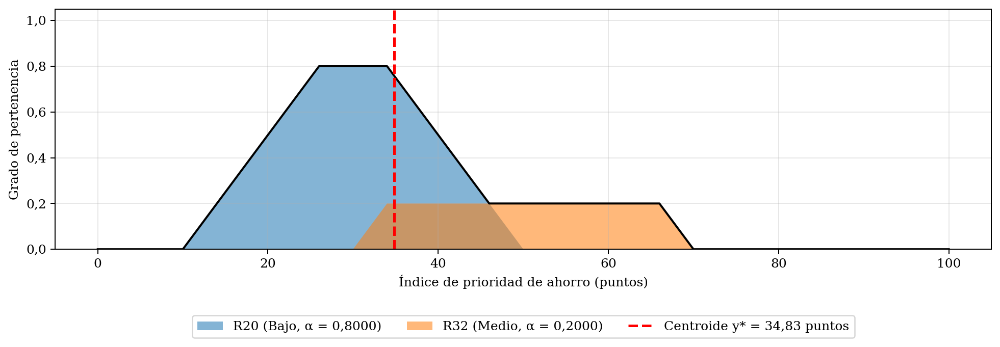

*Nota.* Elaboración propia, generada con los parámetros finales.

## 3.5 Interpretación de la salida

Los soportes de las funciones de salida se superponen para conservar gradualidad. Los intervalos de interpretación son las cinco bandas iguales definidas en la sección 2.2.1 y se presentan en la Tabla 9. Las acciones corresponden a una escala progresiva de revisión y reducción de cargas no esenciales, coherente con las recomendaciones de uso eficiente de Osinergmin (s. f.).

<a id="tabla-9"></a>
**Tabla 9**  
*Interpretación del índice de prioridad de ahorro y acción sugerida*

| **IPA (puntos)** | **Interpretación** | **Acción sugerida**                                  |
|------------------|--------------------|------------------------------------------------------|
| \[0, 20)         | Muy baja           | Mantener monitoreo                                   |
| \[20, 40)        | Baja               | Aplicar recomendaciones de uso eficiente             |
| \[40, 60)        | Media              | Revisar equipos encendidos y consumos en espera      |
| \[60, 80)        | Alta               | Reducir cargas no esenciales                         |
| \[80, 100\]      | Muy alta           | Priorizar desconexión segura de cargas no esenciales |

*Nota.* Elaboración propia. El sistema emite recomendaciones de revisión segura; no desconecta equipos ni sustituye protecciones eléctricas.

**Limitaciones.** (a) La salida depende de que potencia y ocupación se midan de forma confiable. (b) El universo de ocupación hasta 8 personas es el alcance del caso de estudio; un despliegue con hogares mayores debe ampliarlo. (c) El universo de potencia de 0 a 5000 W

# 4. Operadores usados

La configuración es la clásica del sistema Mamdani: mínimo para la intersección y la implicación, máximo para la agregación y centroide para la defuzzificación (Mamdani & Assilian, 1975; Ross, 2010).

## 4.1 Fuzzificación

Cada entrada numérica *x* se transforma en grados de pertenencia mediante las funciones de las ecuaciones (2) a (4). Una misma entrada puede pertenecer parcialmente a dos etiquetas contiguas (Zadeh, 1965).

## 4.2 Intersección (AND)

El conectivo Y de los antecedentes se representa con el operador mínimo. El grado de activación de la regla *i* es:

$$
\alpha_{i} = \text{mín}\left( \mu_{1},\ \mu_{2},\ \mu_{3} \right) \tag{5}
$$

donde α<sub>i</sub> es el grado de activación de la regla *i*, y μ<sub>1</sub>, μ<sub>2</sub> y μ<sub>3</sub> son los grados de pertenencia de la potencia, de los ocupantes y del bloque horario en el antecedente de la regla.

## 4.3 Implicación

La implicación de Mamdani recorta el consecuente al nivel de activación:

$$
\mu_{B'i}(y) = \text{mín}\left( \alpha_{i},\ \mu_{Bi}(y) \right) \tag{6}
$$

donde μ<sub>Bi</sub>(*y*) es la función de pertenencia de la etiqueta de salida de la regla *i* y μ<sub>B′i</sub>(*y*) el conjunto resultante tras el recorte.

## 4.4 Agregación

Los conjuntos recortados de las *n* reglas se combinan con el operador máximo:

$$
\mu_{agg}(y) = \text{máx}\left( \mu_{B'1}(y),\ \ldots,\ \mu_{B'n}(y) \right) \tag{7}
$$

## 4.5 Defuzzificación

Se usa el centroide del conjunto agregado:

$$
y^{*} = \frac{\int_{0}^{100}{y\mu_{agg}(y)dy}}{\int_{0}^{100}{\mu_{agg}(y)dy}} \tag{8}
$$

En la implementación se discretiza el universo en puntos *y*ⱼ:

$$
y^{*} \approx \frac{\sum_{j}^{}{y_{j}\mu_{agg}\left( y_{j} \right)}}{\sum_{j}^{}{\mu_{agg}\left( y_{j} \right)}} \tag{9}
$$

donde *y*ⱼ es el j-ésimo punto de la malla de salida. Si el denominador es cero, ninguna regla se activó y el centroide no está definido; el sistema no emite recomendación. En la base de la Tabla 6 este caso no ocurre en los universos definidos, porque cada variable tiene al menos una etiqueta con pertenencia positiva.

El centroide produce una salida continua que considera la forma completa del conjunto agregado y no solo su pico, lo que es deseable en una recomendación gradual (Ross, 2010; Van Leekwijck & Kerre, 1999).

## 4.6 Justificación de Mamdani frente a Sugeno

El modelo de Takagi y Sugeno (1985) usa consecuentes funcionales y es adecuado para ajustes numéricos basados en datos (Jang et al., 1997). Mamdani mantiene consecuentes lingüísticos, por lo que facilita explicar cada regla (Jang et al., 1997; Zimmermann, 2001). En este trabajo los consecuentes no se asignan de forma aislada: se calculan mediante la función ordinal de la sección 3.1. Sugeno queda como alternativa para una calibración futura con datos.

## 4.7 Resumen de operadores y glosario de símbolos

La Tabla 10 resume los operadores, la Tabla 11 define todos los símbolos empleados y la Tabla 12 vincula las principales decisiones con sus fuentes.

<a id="tabla-10"></a>
**Tabla 10**  
*Operadores utilizados en el sistema de inferencia Mamdani*

| **Etapa**          | **Operador**                       | **Función**                   | **Ecuación** |
|--------------------|------------------------------------|-------------------------------|--------------|
| Fuzzificación      | Funciones triangular y trapezoidal | Obtener grados de pertenencia | (2)–(4)      |
| Antecedentes (AND) | Mínimo                             | Activación de la regla        | (5)        |
| Implicación        | Mínimo                             | Recortar el consecuente       | (6)        |
| Agregación         | Máximo                             | Combinar las reglas           | (7)        |
| Defuzzificación    | Centroide                          | Obtener el IPA numérico       | (8)–(9)      |

*Nota.* Elaboración propia.

<a id="tabla-11"></a>
**Tabla 11**  
*Glosario de símbolos*

| **Símbolo**    | **Significado**                         | **Unidad**            | **Ecuación o sección donde se define** |
|----------------|-----------------------------------------|-----------------------|----------------------------------------|
| $P(t)$       | Potencia eléctrica instantánea          | W                     | (1)                                  |
| $E$          | Energía eléctrica acumulada             | Wh                    | (1)                                  |
| $t$          | Tiempo de integración                   | h                     | (1)                                  |
| $t_{1}$      | Inicio del intervalo de integración     | h                     | (1)                                  |
| $t_{2}$      | Fin del intervalo de integración        | h                     | (1)                                  |
| $x$          | Argumento de una función de pertenencia | Según variable        | (2)–(3)                                |
| $a$          | Primer vértice                          | Según variable        | (2)–(3)                                |
| $b$          | Segundo vértice                         | Según variable        | (2)–(3)                                |
| $c$          | Tercer vértice                          | Según variable        | (2)–(3)                                |
| $d$          | Cuarto vértice                          | Según variable        | (3)                                  |
| $\mu$        | Grado de pertenencia                    | Adimensional \[0, 1\] | (2)–(7)                                |
| $\mu_{tri}$  | Función triangular                      | Adimensional          | (2)                                  |
| $\mu_{trap}$ | Función trapezoidal                     | Adimensional          | (3)–(4)                                |
| $h$          | Hora del día                            | h                     | (4)                                  |
| $\alpha_{i}$ | Grado de activación de la regla i       | Adimensional          | (5)–(6)                                |
| $\mu_{Bi}$   | Función del consecuente de la regla i   | Adimensional          | (6)                                  |
| $\mu_{B'i}$  | Consecuente recortado de la regla i     | Adimensional          | (6)–(7)                                |
| $\mu_{agg}$  | Conjunto de salida agregado             | Adimensional          | (7)–(9)                                |
| $y$          | Variable de salida IPA                  | Puntos                | (6)–(8)                                |
| $y^{*}$      | Salida defuzzificada                    | Puntos                | (8)–(9)                                |
| $y_{j}$      | Punto j de la malla de salida           | Puntos                | (9)                                  |
| $i$          | Índice de regla                         | Adimensional          | (5)–(7)                                |
| $j$          | Índice de discretización                | Adimensional          | (9)                                  |
| $n$          | Número de reglas agregadas              | Reglas                | (7)                                  |
| $N$          | Número de ocupantes                     | Personas              | Sección 2.1.1                          |
| $r_{P}$      | Rango ordinal de potencia               | Entero                | Sección 3.1                            |
| $r_{O}$      | Ajuste por ausencia de ocupantes        | Entero                | Sección 3.1                            |
| $r_{H}$      | Rango ordinal del bloque horario        | Entero                | Sección 3.1                            |
| $S$          | Suma ordinal antes del límite \[0, 4\]  | Entero                | Sección 3.1                            |

*Nota.* Elaboración propia.

<a id="tabla-12"></a>
**Tabla 12**  
*Matriz de trazabilidad de las afirmaciones principales*

| **Afirmación o decisión**                                                                                                          | **Fuente**                                        | **Localización**                                     | **Apartado**      |
|------------------------------------------------------------------------------------------------------------------------------------|---------------------------------------------------|------------------------------------------------------|-------------------|
| Universo superior de potencia de 5000 W                                                                                            | MINEM (2006)                                      | Regla 050-110                                        | 2.1.1             |
| Anclajes de 500, 1500 y 3500 W                                                                                                     | Osinergmin (s. f.)                                | Folleto, p. 1                                        | 2.1.1             |
| Grupos de tamaño de hogar                                                                                                          | INEI (2018)                                       | pp. 375–376                                          | 2.1.1             |
| Punta 18:00–23:00                                                                                                                  | Osinergmin (2013)                                 | Numeral 4.9                                          | 2.1.1             |
| Base 23:00–08:00 y Media 08:00–18:00                                                                                               | Osinergmin (2023)                                 | Numeral 4.9, b.1–b.2                                 | 2.1.1             |
| Base/Media reducen y Punta incrementa tarifa                                                                                       | Osinergmin (2024)                                 | Artículo principal                                   | 3.1               |
| La presencia y las actividades modifican la demanda, sin justificar una gradación ordinal universal entre categorías con presencia | Kavousian et al. (2013); Richardson et al. (2010) | Artículos completos                                  | 1.1; 3.1          |
| La vivienda sin ocupantes puede mantener consumo en espera reducible; se aplica O1                                                 | IEA (2001); Şahin y Aydinalp Koksal (2014)        | Informe y artículo                                   | 3.1; Tabla 6      |
| Uso de reglas lingüísticas Mamdani                                                                                                 | Mamdani y Assilian (1975)                         | Artículo completo                                    | 1.1; 4            |
| Criterios del centroide                                                                                                            | Van Leekwijck y Kerre (1999)                      | Artículo completo                                    | 4.5               |
| Selección conjunta de demanda, tarifa y presencia para control de carga residencial                                                | Keshtkar et al. (2015)                            | Artículo completo; DOI 10.1016/j.enbuild.2015.06.068 | 1.1; 3.1; Tabla 5 |
| Generación combinatoria de reglas en un HEMS difuso                                                                                | Ain et al. (2018)                                 | Secciones 3.1 y 4; DOI 10.3390/s18092802             | 3.1; Tabla 6      |
| Rechazo de entradas fuera del dominio y recalibración del universo de potencia                                                     | MINEM (2006)                                      | Regla 050-110                                        | 2.1.1             |

*Nota.* Elaboración propia. Las localizaciones oficiales y los DOI se verificaron en las fuentes primarias indicadas.

# 5. Desarrollo en Python

Una vez definidos los universos de discurso, las funciones de membresía, la base de reglas y los operadores difusos, se procedió a implementar el sistema en Python. La solución se diseñó de manera modular, separando la definición del modelo difuso, el proceso de inferencia, la validación de datos, la generación de gráficas y la comunicación con la interfaz web.

Esta separación permite modificar una parte del sistema sin afectar innecesariamente a las demás. Por ejemplo, las funciones de membresía se definen una sola vez y son reutilizadas por el motor de inferencia, la API y el módulo de generación de gráficas.

## 5.1 Entorno y bibliotecas

El backend fue desarrollado con Python 3.11. Las dependencias se registraron con versiones específicas en el archivo `requirements.txt`, con el propósito de obtener instalaciones reproducibles tanto en el entorno local como en el servidor de despliegue. Las principales bibliotecas utilizadas se resumen en la Tabla 13.

<a id="tabla-13"></a>
**Tabla 13**  
*Bibliotecas principales del proyecto y su aplicación*

| **Biblioteca**    | **Versión** | **Aplicación en el proyecto**                      |
|-------------------|-------------|----------------------------------------------------|
| FastAPI           | 0.142.4     | Implementación de la API REST                      |
| Uvicorn           | 0.54.0      | Servidor ASGI para ejecutar la aplicación          |
| Pydantic          | 2.13.5      | Validación de solicitudes y definición de esquemas |
| pydantic-settings | 2.15.0      | Lectura y validación de la configuración           |
| NumPy             | 2.4.6       | Creación de universos y operaciones vectorizadas   |
| SciPy             | 1.17.1      | Soporte para el entorno de cálculo científico      |
| scikit-fuzzy      | 0.5.0       | Funciones de membresía y defuzzificación           |
| Matplotlib        | 3.11.2      | Generación de las gráficas del sistema             |
| python-dotenv     | 1.2.4       | Lectura de variables de entorno                    |

*Nota.* Elaboración propia a partir del archivo `requirements.txt` del proyecto.

Para el desarrollo y las pruebas también se incorporaron `pytest`, `httpx`, `Ruff` y `Black`. Estas herramientas se emplearon, respectivamente, para ejecutar pruebas automatizadas, probar la API, analizar el código y mantener un formato uniforme.

La instalación local puede realizarse mediante un entorno virtual:

```powershell
python -m venv .venv
.venv\Scripts\Activate.ps1
pip install -r requirements.txt
```

El proyecto se organizó de la siguiente manera:

```text
proyecto_difuso/
├── core/
│   ├── config.py
│   ├── exceptions.py
│   └── logging_config.py
├── fuzzy/
│   ├── membresias.py
│   ├── reglas.py
│   ├── motor.py
│   ├── interpretacion.py
│   └── graficos.py
├── routers/
│   └── api.py
├── schemas/
│   └── difuso.py
├── services/
│   └── difuso_service.py
├── tests/
├── cli.py
├── main.py
├── requirements.txt
└── Dockerfile
```

El paquete `fuzzy` contiene la lógica principal del sistema. Los esquemas de entrada y salida se encuentran en `schemas`, mientras que `services` conecta el motor difuso con la API. Los endpoints HTTP se definen en `routers`, y `main.py` inicializa la aplicación FastAPI.

La configuración se carga desde variables de entorno o desde un archivo `.env`. Entre los parámetros configurables se encuentran el entorno de ejecución, los orígenes permitidos por CORS, el nivel de registro, el tamaño máximo de los lotes y la resolución del universo de salida.

La aplicación también fue preparada para ejecutarse dentro de un contenedor basado en `python:3.11-slim`. En producción, Uvicorn escucha el puerto definido mediante la variable `PORT`.

## 5.2 Definición de las variables

Las variables difusas se implementaron en el archivo `fuzzy/membresias.py`. En lugar de almacenar sus datos en arreglos independientes, se definieron estructuras reutilizables mediante clases de datos inmutables. Las tres estructuras principales son:

- `Componente`: representa una función triangular o trapezoidal.

- `ConjuntoDifuso`: representa una etiqueta lingüística formada por uno o más componentes.

- `VariableDifusa`: representa una variable completa, incluyendo su universo y sus conjuntos.

La estructura utilizada para una variable difusa es la siguiente:

```python
@dataclass(frozen=True)
class VariableDifusa:
    clave: str
    nombre: str
    unidad: str
    minimo: float
    maximo: float
    conjuntos: tuple[ConjuntoDifuso, ...]
```

El modificador `frozen=True` hace que los objetos sean inmutables después de su creación. De esta manera se evita que los parámetros del modelo cambien accidentalmente durante una evaluación.

Cada variable almacena dos tipos de identificadores. La `clave` se utiliza internamente en el código, mientras que el `nombre` y las etiquetas se utilizan para presentar la información al usuario. Por ejemplo, la clave técnica `manana` representa la etiqueta visible «Mañana».

La variable de consumo se define en Python de la siguiente forma:

```python
CONSUMO = VariableDifusa(
    clave="consumo",
    nombre="Consumo eléctrico",
    unidad="W",
    minimo=0.0,
    maximo=3000.0,
    conjuntos=(
        ConjuntoDifuso(
            "bajo",
            "Bajo",
            (_trap(0, 0, 500, 1200),),
        ),
        ConjuntoDifuso(
            "medio",
            "Medio",
            (_tri(700, 1500, 2200),),
        ),
        ConjuntoDifuso(
            "alto",
            "Alto",
            (_trap(1800, 2500, 3000, 3000),),
        ),
    ),
)
```

Las demás variables se construyeron con la misma estructura. Finalmente, todas se registraron en un diccionario de solo lectura:

```python
VARIABLES = MappingProxyType(
    {
        variable.clave: variable
        for variable in (CONSUMO, PERSONAS, HORA, SALIDA)
    }
)
```

Este diccionario permite que otros módulos accedan a las variables sin duplicar sus definiciones. Por tanto, `membresias.py` funciona como la única fuente de verdad para los universos y parámetros del modelo.

La clase `VariableDifusa` también contiene la validación de las entradas. Antes de fuzzificar un valor, se comprueba que sea numérico, finito y que pertenezca al universo correspondiente:

```python
def validar(self, valor: float) -> float:
    numero = float(valor)

    if not math.isfinite(numero):
        raise EntradaFueraDeRangoError(
            f"{self.nombre}: el valor debe ser finito"
        )

    if not self.minimo <= numero <= self.maximo:
        raise EntradaFueraDeRangoError(
            f"{self.nombre}: valor fuera del universo"
        )

    return numero
```

Los datos incorrectos no se limitan ni corrigen silenciosamente. Si se recibe un valor fuera del dominio, la evaluación es rechazada con un mensaje controlado.

Además de la validación realizada por el motor, la API utiliza modelos de Pydantic. Por ejemplo, el esquema de una evaluación establece directamente los límites permitidos:

```python
class EvaluacionRequest(BaseModel):
    consumo_w: float = Field(ge=0, le=3000)
    personas: float = Field(ge=0, le=6)
    hora: float = Field(ge=0, le=24)
```

Por lo tanto, las entradas son verificadas tanto en la frontera de la API como en el núcleo del sistema.

## 5.3 Funciones de membresía

Las funciones de membresía se implementaron mediante los métodos `trapmf` y `trimf` de scikit-fuzzy. La selección de la función se encapsuló en la clase `Componente`:

```python
@dataclass(frozen=True)
class Componente:
    tipo: TipoFuncion
    params: tuple[float, ...]

    def evaluar(self, x: FloatArray) -> FloatArray:
        if self.tipo == "trapezoidal":
            return fuzz.trapmf(x, list(self.params))

        return fuzz.trimf(x, list(self.params))
```

Antes de utilizar un componente, el método `__post_init__` comprueba que la cantidad de parámetros sea correcta y que estos se encuentren en orden no decreciente. Una función triangular debe tener tres parámetros y una trapezoidal debe tener cuatro.

Para simplificar la construcción de las variables se crearon dos funciones auxiliares:

```python
def _trap(*params: float) -> Componente:
    return Componente(
        "trapezoidal",
        tuple(float(p) for p in params),
    )


def _tri(*params: float) -> Componente:
    return Componente(
        "triangular",
        tuple(float(p) for p in params),
    )
```

Cada conjunto difuso puede estar formado por uno o más componentes. Cuando contiene más de uno, sus resultados se combinan mediante `np.fmax`, equivalente a la operación de unión por máximo:

```python
def evaluar(self, x: FloatArray) -> FloatArray:
    resultado = self.componentes[0].evaluar(x)

    for componente in self.componentes[1:]:
        resultado = np.fmax(
            resultado,
            componente.evaluar(x),
        )

    return resultado
```

Este comportamiento se emplea para implementar la naturaleza circular de la variable hora. Por ejemplo, «Madrugada» se construye uniendo una función correspondiente a las primeras horas del día con otra ubicada al final del intervalo:

```python
ConjuntoDifuso(
    "madrugada",
    "Madrugada",
    (
        _trap(0, 0, 4, 7),
        _trap(22, 24, 24, 24),
    ),
)
```

La fuzzificación de un valor se realiza con el método `fuzzificar()`. El valor validado se convierte en un arreglo de NumPy y se evalúa en todos los conjuntos de la variable:

```python
def fuzzificar(self, valor: float) -> dict[str, float]:
    x = np.array(
        [self.validar(valor)],
        dtype=np.float64,
    )

    return {
        conjunto.clave:
            float(conjunto.evaluar(x)[0])
        for conjunto in self.conjuntos
    }
```

El resultado es un diccionario que contiene el grado de pertenencia del valor a cada etiqueta lingüística. Sobre este método general se definieron funciones específicas:

```python
def fuzzificar_consumo(w: float) -> dict[str, float]:
    return CONSUMO.fuzzificar(w)


def fuzzificar_personas(n: float) -> dict[str, float]:
    return PERSONAS.fuzzificar(n)


def fuzzificar_hora(h: float) -> dict[str, float]:
    return HORA.fuzzificar(h)
```

Para la variable de salida se construye un universo numérico entre 0 y 100. El paso predeterminado es 0,01, por lo que el universo contiene 10 001 puntos. Las funciones correspondientes se calculan una sola vez y se conservan mediante `lru_cache`. Este mecanismo evita reconstruir los mismos arreglos en cada solicitud y reduce el tiempo necesario para realizar múltiples evaluaciones.

## 5.4 Base de reglas

La base de conocimiento se implementó en `fuzzy/reglas.py`. Cada regla se representa mediante una clase de datos inmutable:

```python
@dataclass(frozen=True)
class Regla:
    id: str
    consumo: str
    personas: str
    hora: str
    salida: str
```

En lugar de escribir las 36 reglas como objetos separados, se almacenó primero la tabla de decisiones en una estructura compacta. Cada fila contiene una combinación de consumo y personas, seguida de las salidas para Madrugada, Mañana, Tarde y Noche:

```python
_TABLA_8 = (
    ("Bajo", "Pocas", ("M", "B", "B", "M")),
    ("Bajo", "Moderadas", ("B", "MB", "MB", "B")),
    ("Bajo", "Muchas", ("MB", "MB", "MB", "MB")),
    ("Medio", "Pocas", ("MA", "M", "A", "A")),
    ("Medio", "Moderadas", ("A", "B", "M", "M")),
    ("Medio", "Muchas", ("M", "MB", "B", "B")),
    ("Alto", "Pocas", ("MA", "MA", "MA", "MA")),
    ("Alto", "Moderadas", ("MA", "A", "A", "MA")),
    ("Alto", "Muchas", ("A", "M", "M", "A")),
)
```

Las abreviaturas se traducen mediante un diccionario:

```python
ABREVIATURAS_SALIDA = {
    "MB": "Muy bajo",
    "B": "Bajo",
    "M": "Medio",
    "A": "Alto",
    "MA": "Muy alto",
}
```

La Tabla 14 presenta el contenido de la tabla de decisiones con las etiquetas completas y los identificadores de regla que se generan a partir de ella.

<a id="tabla-14"></a>
**Tabla 14**  
*Salida de la base de reglas según consumo, personas y bloque horario*

| **Reglas** | **Consumo** | **Personas** | **Madrugada** | **Mañana** | **Tarde** | **Noche** |
|------------|-------------|--------------|---------------|------------|-----------|-----------|
| R1–R4      | Bajo        | Pocas        | Medio         | Bajo       | Bajo      | Medio     |
| R5–R8      | Bajo        | Moderadas    | Bajo          | Muy bajo   | Muy bajo  | Bajo      |
| R9–R12     | Bajo        | Muchas       | Muy bajo      | Muy bajo   | Muy bajo  | Muy bajo  |
| R13–R16    | Medio       | Pocas        | Muy alto      | Medio      | Alto      | Alto      |
| R17–R20    | Medio       | Moderadas    | Alto          | Bajo       | Medio     | Medio     |
| R21–R24    | Medio       | Muchas       | Medio         | Muy bajo   | Bajo      | Bajo      |
| R25–R28    | Alto        | Pocas        | Muy alto      | Muy alto   | Muy alto  | Muy alto  |
| R29–R32    | Alto        | Moderadas    | Muy alto      | Alto       | Alto      | Muy alto  |
| R33–R36    | Alto        | Muchas       | Alto          | Medio      | Medio     | Alto      |

*Nota.* Elaboración propia a partir de la estructura `_TABLA_8` de `fuzzy/reglas.py`. Los identificadores se asignan en orden de recorrido: cada fila genera cuatro reglas consecutivas.

La función `_construir_reglas()` recorre la tabla y genera automáticamente los objetos desde `R1` hasta `R36`:

```python
def _construir_reglas() -> tuple[Regla, ...]:
    reglas = []

    for consumo, personas, salidas in _TABLA_8:
        for hora, abreviatura in zip(
            ORDEN_HORAS,
            salidas,
            strict=True,
        ):
            reglas.append(
                Regla(
                    id=f"R{len(reglas) + 1}",
                    consumo=consumo,
                    personas=personas,
                    hora=hora,
                    salida=ABREVIATURAS_SALIDA[
                        abreviatura
                    ],
                )
            )

    return tuple(reglas)
```

Las reglas resultantes se almacenan en una tupla inmutable:

```python
REGLAS = _construir_reglas()
```

Después de construirlas se ejecuta `validar_reglas()`. Esta función comprueba que:

- Existan exactamente 36 reglas.

- Los identificadores sean únicos y consecutivos.

- Todas las etiquetas correspondan a conjuntos existentes.

- No haya antecedentes duplicados.

- Estén presentes todas las combinaciones posibles.

La validación se ejecuta al importar el módulo. Si la base contiene una inconsistencia, la aplicación no inicia y genera un error de configuración. De esta forma se impide que el motor trabaje con una base incompleta.

También se implementó `generar_reglas_heuristica()`, que reproduce la tabla mediante los criterios numéricos definidos en la sección 3. Esta función no interviene directamente en las evaluaciones; se utiliza como mecanismo de auditoría para comprobar que la tabla programada coincide con la heurística establecida.

## 5.5 Sistema de control y simulación

El proceso de inferencia se implementó en la función `evaluar()` del archivo `fuzzy/motor.py`. Esta función recibe los tres valores de entrada y devuelve un objeto `ResultadoInferencia`. El flujo implementado se muestra en la Figura 5.

<a id="figura-5"></a>
**Figura 5**  
*Flujo de procesamiento del sistema difuso, desde la solicitud hasta la respuesta*

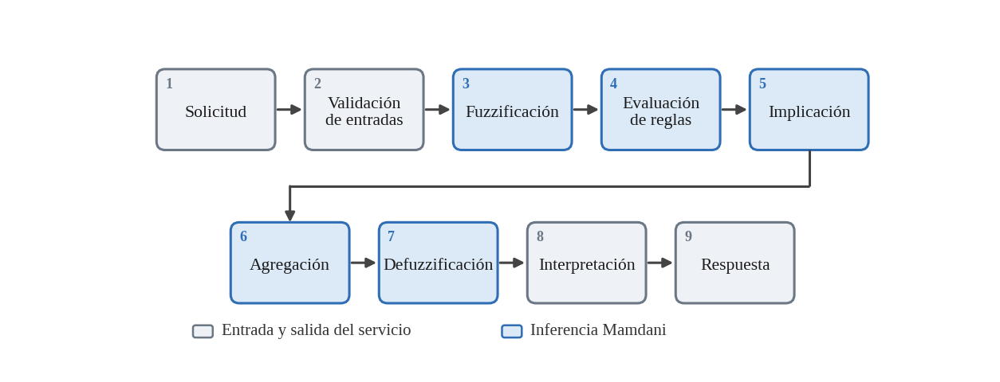

*Nota.* Elaboración propia. Las etapas 3 a 7 corresponden al sistema de inferencia de tipo Mamdani.

Primero se fuzzifican las entradas y se obtiene el universo de salida:

```python
mu_consumo = fuzzificar_consumo(consumo_w)
mu_personas = fuzzificar_personas(personas)
mu_hora = fuzzificar_hora(hora)
salida = funciones_salida(paso_salida)
```

Después se crea un arreglo inicialmente vacío para almacenar el resultado agregado:

```python
agregado = np.zeros_like(salida.universo)
activadas = []
```

El motor recorre las 36 reglas. Para cada una obtiene los grados de pertenencia de sus antecedentes y calcula su nivel de activación:

```python
g_consumo = mu_consumo[k_consumo]
g_personas = mu_personas[k_personas]
g_hora = mu_hora[k_hora]

alpha = min(
    g_consumo,
    g_personas,
    g_hora,
)
```

Cuando `alpha` es igual a cero, la regla no contribuye al resultado y se omite:

```python
if alpha <= 0.0:
    continue
```

Para las reglas activas, la función de salida se recorta mediante el operador mínimo. El resultado se incorpora al conjunto acumulado utilizando el operador máximo:

```python
recorte = np.minimum(
    alpha,
    salida.funciones[k_salida],
)

agregado = np.maximum(
    agregado,
    recorte,
)
```

Por cada regla activa se conserva su identificador, sus antecedentes, su consecuente, su valor de activación y una representación textual del cálculo. Esto permite presentar el procedimiento de inferencia paso a paso en la interfaz o en la línea de comandos.

Antes de realizar la defuzzificación se verifica que el área agregada no sea nula:

```python
if not np.any(agregado > 0.0):
    raise DefuzzificacionError(
        "Área agregada nula"
    )
```

Finalmente, el valor representativo se obtiene mediante el centroide:

```python
centroide = float(
    fuzz.defuzz(
        salida.universo,
        agregado,
        "centroid",
    )
)
```

El valor interno no se redondea dentro del motor. El redondeo se realiza únicamente cuando se prepara la respuesta de la API, conservando dos decimales para el resultado y cuatro para los grados de pertenencia y activación. El resultado completo se almacena en la siguiente estructura:

```python
@dataclass(frozen=True, eq=False)
class ResultadoInferencia:
    entradas: dict[str, float]
    salida_pct: float
    interpretacion: str
    accion_sugerida: str
    fuzzificacion: dict[str, dict[str, float]]
    reglas_activadas: list[ReglaActivada]
    universo: FloatArray
    agregado: FloatArray
```

La función del motor es pura, ya que no modifica variables globales ni utiliza estado compartido. Cada evaluación crea sus propios arreglos temporales. Las reglas son inmutables y las funciones de salida precalculadas se mantienen como arreglos de solo lectura. Esto permite que varias evaluaciones se ejecuten concurrentemente sin utilizar bloqueos.

### Verificación mediante un caso de simulación

Para comprobar el funcionamiento del motor se utilizó el caso de consumo de 1900 W, 3 personas y hora 12:00. La ejecución desde la línea de comandos puede realizarse así:

```powershell
python cli.py `
    --consumo 1900 `
    --personas 3 `
    --hora 12 `
    --detalle
```

El programa obtuvo los grados de pertenencia que se muestran en la Tabla 15.

<a id="tabla-15"></a>
**Tabla 15**  
*Grados de pertenencia obtenidos para 1900 W, 3 personas y 12:00 h*

| **Variable** | **Etiqueta** | **Grado de pertenencia** |
|--------------|--------------|--------------------------|
| Consumo      | Bajo         | 0,0000                   |
|              | Medio        | 0,4286                   |
|              | Alto         | 0,1429                   |
| Personas     | Pocas        | 0,0000                   |
|              | Moderadas    | 1,0000                   |
|              | Muchas       | 0,0000                   |
| Hora         | Madrugada    | 0,0000                   |
|              | Mañana       | 0,2500                   |
|              | Tarde        | 0,2500                   |
|              | Noche        | 0,0000                   |

*Nota.* Elaboración propia a partir de la salida de `cli.py`.

Se activaron las reglas R18, R19, R30 y R31 (Tabla 16). Después de aplicar la implicación, la agregación y la defuzzificación se obtuvo:

<a id="tabla-16"></a>
**Tabla 16**  
*Reglas activadas para 1900 W, 3 personas y 12:00 h*

| **Regla** | **Consumo** | **Personas** | **Hora** | **Salida** | **α**  | **Cálculo**                 |
|-----------|-------------|--------------|----------|------------|--------|-----------------------------|
| R18       | Medio       | Moderadas    | Mañana   | Bajo       | 0,2500 | mín(0,4286; 1,0000; 0,2500) |
| R19       | Medio       | Moderadas    | Tarde    | Medio      | 0,2500 | mín(0,4286; 1,0000; 0,2500) |
| R30       | Alto        | Moderadas    | Mañana   | Alto       | 0,1429 | mín(0,1429; 1,0000; 0,2500) |
| R31       | Alto        | Moderadas    | Tarde    | Alto       | 0,1429 | mín(0,1429; 1,0000; 0,2500) |

*Nota.* Elaboración propia. Los niveles de activación α se obtienen como el mínimo de los grados de pertenencia de la Tabla 15; la salida de cada regla corresponde a la Tabla 14.

```text
Resultado = 46.72
Interpretación = Ahorro moderado
Acción sugerida = Apagar equipos no esenciales
```

Este caso se conserva como prueba de referencia de la implementación: las reglas activadas y sus niveles de activación pueden contrastarse con el procedimiento manual descrito en la sección 3.4.

### Acceso mediante API

El motor se integró con FastAPI mediante la clase `DifusoService`. Esta capa transforma los resultados internos en esquemas de respuesta, registra las operaciones y convierte los errores del dominio en respuestas controladas. Los principales endpoints implementados se presentan en la Tabla 17.

<a id="tabla-17"></a>
**Tabla 17**  
*Endpoints principales de la API*

| **Método** | **Endpoint**                       | **Función**                                       |
|------------|------------------------------------|---------------------------------------------------|
| POST       | `/api/evaluar`                | Ejecuta una evaluación individual                 |
| POST       | `/api/evaluar/lote`           | Evalúa varias entradas                            |
| POST       | `/api/barrido`                | Varía una entrada y mantiene las demás constantes |
| GET        | `/api/reglas`                 | Devuelve la base de reglas                        |
| GET        | `/api/membresias`             | Devuelve las curvas muestreadas                   |
| GET        | `/api/grafico/agregacion`     | Genera la gráfica de una inferencia               |
| GET        | `/api/grafico/membresias/{n}` | Genera las gráficas de membresía                  |
| GET        | `/health`                     | Verifica el funcionamiento del servicio           |

*Nota.* Elaboración propia a partir de los endpoints definidos en `routers/api.py`.

Una solicitud de evaluación tiene la siguiente forma:

```json
{
  "consumo_w": 1900,
  "personas": 3,
  "hora": 12
}
```

La respuesta incluye el resultado, la interpretación, la acción sugerida, la fuzzificación y las reglas activadas:

```json
{
  "entradas": {
    "consumo_w": 1900,
    "personas": 3,
    "hora": 12
  },
  "salida_pct": 46.72,
  "interpretacion": "Ahorro moderado",
  "accion_sugerida": "Apagar equipos no esenciales",
  "fuzzificacion": {},
  "reglas_activadas": []
}
```

Los campos `fuzzificacion` y `reglas_activadas` contienen la información detallada de la inferencia; en el ejemplo anterior se muestran vacíos únicamente para abreviar la estructura.

El endpoint de barrido permite estudiar el comportamiento del sistema al modificar progresivamente una variable. Internamente utiliza `numpy.linspace` para producir los valores y ejecuta el motor para cada punto:

```python
for valor in np.linspace(
    req.desde,
    req.hasta,
    req.pasos,
):
    resultado = self._inferir(
        consumo_w,
        personas,
        hora,
    )
```

Este mecanismo se utiliza para observar cómo cambia la recomendación según el consumo, la ocupación o la hora.

## 5.6 Gráficas

Las gráficas se implementaron en `fuzzy/graficos.py` mediante Matplotlib. Se utilizó la API orientada a objetos con `Figure` y `FigureCanvasAgg`, en lugar de `matplotlib.pyplot`:

```python
from matplotlib.backends.backend_agg import FigureCanvasAgg
from matplotlib.figure import Figure
```

Esta decisión permite generar imágenes sin abrir ventanas y evita depender de un estado gráfico global. Por tanto, las figuras pueden producirse dentro del servidor web, incluso cuando existen varias solicitudes concurrentes. La creación de una figura parte de una función auxiliar:

```python
def _nueva_figura(
    ancho: float,
    alto: float,
) -> Figure:
    return Figure(
        figsize=(ancho, alto),
        facecolor="#fcfcfb",
        layout="constrained",
    )
```

Para graficar una variable se genera un conjunto de valores uniformemente distribuidos dentro de su universo. Después se evalúan todos sus conjuntos y se representan sus curvas:

```python
x, curvas = muestrear_variable(
    variable,
    n_puntos=1201,
)

for conjunto in variable.conjuntos:
    mu = curvas[conjunto.clave]

    ax.plot(
        x,
        mu,
        linewidth=2.0,
        label=conjunto.etiqueta,
    )
```

El sistema genera cuatro figuras principales:

- Funciones de membresía del consumo eléctrico y la cantidad de personas.

- Funciones de membresía de la hora, incluyendo su continuidad circular.

- Funciones de membresía de la variable de salida.

- Agregación de los consecuentes y defuzzificación mediante el centroide.

En la cuarta figura se muestran inicialmente las funciones de salida completas con líneas tenues. Después se calcula y representa el recorte correspondiente a cada regla activa:

```python
recorte = np.minimum(
    regla.alpha,
    SALIDA.conjunto(
        regla.salida
    ).evaluar(universo),
)

ax.fill_between(
    universo,
    recorte,
    alpha=0.28,
)
```

El conjunto final agregado se representa mediante una línea continua y un área sombreada:

```python
ax.fill_between(
    universo,
    resultado.agregado,
    alpha=0.12,
    label="Área agregada (MAX)",
)

ax.plot(
    universo,
    resultado.agregado,
    linewidth=2.0,
)
```

El resultado defuzzificado se marca mediante una línea vertical:

```python
ax.axvline(
    resultado.salida_pct,
    linestyle="--",
    label=(
        f"Centroide y* = "
        f"{resultado.salida_pct:.2f} %"
    ),
)
```

Las imágenes se renderizan en formato PNG con una resolución de 200 ppp. Esto permite utilizarlas tanto en la interfaz web como en el documento académico. Las cuatro figuras pueden generarse desde la línea de comandos mediante:

```powershell
python cli.py --figuras-informe figuras
```

Para generar solamente la gráfica de agregación de una evaluación se utiliza:

```powershell
python cli.py `
    --consumo 1900 `
    --personas 3 `
    --hora 12 `
    --grafico figura_4.png
```

La API también puede devolver las imágenes directamente con el tipo de contenido `image/png`. Las figuras de membresía se obtienen mediante `/api/grafico/membresias/{n}`, mientras que la gráfica correspondiente a una evaluación se obtiene mediante `/api/grafico/agregacion`.

De esta manera, la implementación en Python materializa el sistema de inferencia de tipo Mamdani y, al mismo tiempo, proporciona mecanismos para validar entradas, inspeccionar las reglas activadas, realizar simulaciones, exponer el motor mediante una API y generar evidencia gráfica del procedimiento de inferencia.

# 6. Corridas del programa

Para verificar el funcionamiento del sistema se ejecutaron los cuatro casos incluidos en el panel «Casos de ejemplo» de la interfaz web. En cada corrida se registraron las entradas, los grados de pertenencia, las reglas activadas, el conjunto agregado y el valor final del índice de prioridad de ahorro energético (IPA). Los casos evaluados se resumen en la Tabla 18.

<a id="tabla-18"></a>
**Tabla 18**  
*Resumen de las cuatro corridas del programa*

| **Corrida** | **Potencia** | **Ocupantes** | **Hora** | **IPA** | **Interpretación**      |
|-------------|--------------|---------------|----------|---------|-------------------------|
| 1           | 300 W        | 4             | 12:00    | 11,59   | Sin necesidad de ahorro |
| 2           | 1900 W       | 3             | 12:00    | 46,72   | Ahorro moderado         |
| 3           | 1900 W       | 3             | 19:00    | 59,61   | Ahorro moderado         |
| 4           | 2800 W       | 1             | 02:00    | 90,71   | Ahorro crítico          |

*Nota.* Elaboración propia. IPA: índice de prioridad de ahorro energético, en puntos.

Para cada corrida se presentan dos evidencias: la captura de la interfaz con las entradas y el resultado, y la gráfica de agregación y centroide. No se repiten las gráficas generales de membresía (sección 5.6), porque no cambian entre corridas; únicamente varían el punto evaluado, los grados obtenidos y el conjunto agregado.

## 6.1 Corrida 1

La primera corrida representa una situación de bajo consumo eléctrico, con cuatro ocupantes al mediodía (Tabla 19).

<a id="tabla-19"></a>
**Tabla 19**  
*Datos y resultado de la corrida 1*

| **Variable**         | **Valor**               |
|----------------------|-------------------------|
| Potencia instantánea | 300 W                   |
| Ocupantes            | 4 personas              |
| Hora                 | 12:00                   |
| IPA obtenido         | 11,59 puntos            |
| Interpretación       | Sin necesidad de ahorro |
| Acción sugerida      | Ninguna                 |

*Nota.* Elaboración propia a partir de la salida del sistema.

### Fuzzificación

Para una potencia de 300 W, el consumo pertenece completamente al conjunto Bajo (Tabla 20). La hora 12:00 se encuentra en la zona de transición entre los conjuntos Mañana y Tarde, y ambos alcanzan un grado de pertenencia de 0,25.

<a id="tabla-20"></a>
**Tabla 20**  
*Grados de pertenencia de la corrida 1*

| **Variable** | **Etiqueta** | **Grado de pertenencia** |
|--------------|--------------|--------------------------|
| Potencia     | Bajo         | 1,0000                   |
|              | Medio        | 0,0000                   |
|              | Alto         | 0,0000                   |
| Ocupantes    | Pocas        | 0,0000                   |
|              | Moderadas    | 0,5000                   |
|              | Muchas       | 0,0000                   |
| Hora         | Madrugada    | 0,0000                   |
|              | Mañana       | 0,2500                   |
|              | Tarde        | 0,2500                   |
|              | Noche        | 0,0000                   |

*Nota.* Elaboración propia, a partir de la salida del sistema.

### Reglas activadas

Se activaron dos reglas (Tabla 21). Ambas generan el mismo consecuente, «Muy bajo», recortado a una altura de 0,25. Después de la agregación y la defuzzificación se obtiene IPA = 11,59.

<a id="tabla-21"></a>
**Tabla 21**  
*Reglas activadas en la corrida 1*

| **Regla** | **Antecedentes**        | **Consecuente** | **α**  | **Cálculo**                 |
|-----------|-------------------------|-----------------|--------|-----------------------------|
| R6        | Bajo, Moderadas, Mañana | Muy bajo        | 0,2500 | mín(1,0000; 0,5000; 0,2500) |
| R7        | Bajo, Moderadas, Tarde  | Muy bajo        | 0,2500 | mín(1,0000; 0,5000; 0,2500) |

*Nota.* Elaboración propia. α: nivel de activación de la regla.

### Análisis del resultado

El valor de 11,59 se encuentra dentro del intervalo correspondiente a «Sin necesidad de ahorro». El resultado es coherente porque la potencia demandada es reducida y se encuentra completamente dentro del conjunto Bajo. Además, existen cuatro personas presentes, por lo que el consumo puede considerarse proporcional a la ocupación.

Aunque la hora pertenece parcialmente a dos conjuntos, ambos conducen al mismo nivel de salida. Por esta razón, la transición entre Mañana y Tarde no provoca una recomendación más severa.

<a id="figura-5"></a>
**Figura 5**  
*Resultado de la corrida 1 en la interfaz del sistema: 300 W, 4 ocupantes y 12:00 h*

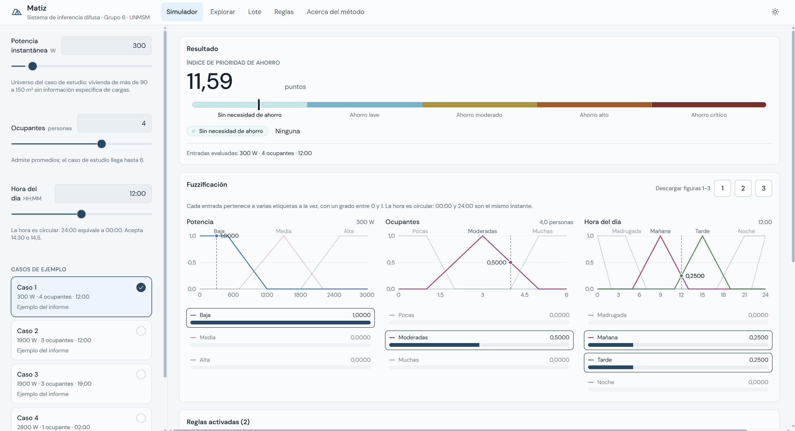

*Nota.* Elaboración propia. Captura de la interfaz web del sistema.

<a id="figura-6"></a>
**Figura 6**  
*Agregación del conjunto «Muy bajo» y centroide de 11,59 puntos para la corrida 1*

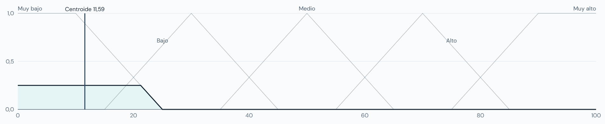

*Nota.* Elaboración propia, generada por el sistema con los parámetros finales.

## 6.2 Corrida 2

La segunda corrida evalúa un consumo intermedio con tres ocupantes al mediodía (Tabla 22).

<a id="tabla-22"></a>
**Tabla 22**  
*Datos y resultado de la corrida 2*

| **Variable**         | **Valor**                    |
|----------------------|------------------------------|
| Potencia instantánea | 1900 W                       |
| Ocupantes            | 3 personas                   |
| Hora                 | 12:00                        |
| IPA obtenido         | 46,72 puntos                 |
| Interpretación       | Ahorro moderado              |
| Acción sugerida      | Apagar equipos no esenciales |

*Nota.* Elaboración propia a partir de la salida del sistema.

### Fuzzificación

La potencia de 1900 W pertenece simultáneamente a los conjuntos Medio y Alto (Tabla 23). Los tres ocupantes pertenecen completamente al conjunto Moderadas y, al igual que en la primera corrida, las 12:00 se encuentran en la intersección entre Mañana y Tarde.

<a id="tabla-23"></a>
**Tabla 23**  
*Grados de pertenencia de la corrida 2*

| **Variable** | **Etiqueta** | **Grado de pertenencia** |
|--------------|--------------|--------------------------|
| Potencia     | Bajo         | 0,0000                   |
|              | Medio        | 0,4286                   |
|              | Alto         | 0,1429                   |
| Ocupantes    | Pocas        | 0,0000                   |
|              | Moderadas    | 1,0000                   |
|              | Muchas       | 0,0000                   |
| Hora         | Madrugada    | 0,0000                   |
|              | Mañana       | 0,2500                   |
|              | Tarde        | 0,2500                   |
|              | Noche        | 0,0000                   |

*Nota.* Elaboración propia, a partir de la salida del sistema.

### Reglas activadas

Se activaron cuatro reglas (Tabla 24) que producen tres conjuntos de salida diferentes:

<a id="tabla-24"></a>
**Tabla 24**  
*Reglas activadas en la corrida 2*

| **Regla** | **Antecedentes**         | **Consecuente** | **α**  | **Cálculo**                 |
|-----------|--------------------------|-----------------|--------|-----------------------------|
| R18       | Medio, Moderadas, Mañana | Bajo            | 0,2500 | mín(0,4286; 1,0000; 0,2500) |
| R19       | Medio, Moderadas, Tarde  | Medio           | 0,2500 | mín(0,4286; 1,0000; 0,2500) |
| R30       | Alto, Moderadas, Mañana  | Alto            | 0,1429 | mín(0,1429; 1,0000; 0,2500) |
| R31       | Alto, Moderadas, Tarde   | Alto            | 0,1429 | mín(0,1429; 1,0000; 0,2500) |

*Nota.* Elaboración propia.

- Bajo, recortado a 0,25.

- Medio, recortado a 0,25.

- Alto, recortado a 0,1429.

Las reglas R30 y R31 tienen el mismo consecuente. Al aplicarse la agregación por máximo, el conjunto Alto permanece recortado a 0,1429 y no se suman ambas activaciones. El centroide resultante es IPA = 46,72.

### Análisis del resultado

El resultado corresponde a «Ahorro moderado». La pertenencia principal del consumo se encuentra en el conjunto Medio, pero también existe una pertenencia parcial al conjunto Alto. Esto desplaza el centroide hacia la región central y superior de la salida.

La presencia de tres personas evita que el resultado alcance inmediatamente una prioridad alta, ya que el consumo puede estar parcialmente justificado por la ocupación. Sin embargo, 1900 W continúa siendo un valor significativo, por lo que el sistema recomienda apagar los equipos no esenciales.

Este caso también muestra el efecto de las zonas de solapamiento: una misma entrada puede activar simultáneamente reglas con consecuentes Bajo, Medio y Alto. El resultado final no se selecciona a partir de una sola regla, sino del centroide de todos los conjuntos agregados.

<a id="figura-7"></a>
**Figura 7**  
*Resultado de la corrida 2 en la interfaz del sistema: 1900 W, 3 ocupantes y 12:00 h*

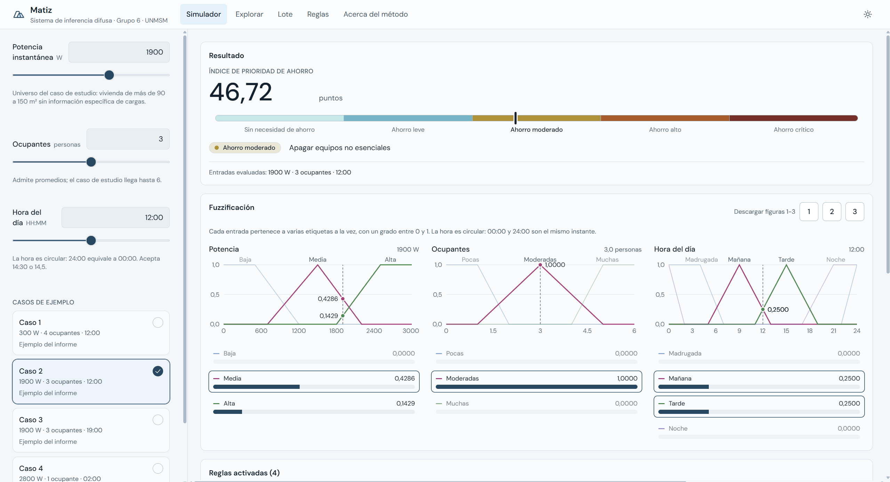

*Nota.* Elaboración propia. Captura de la interfaz web del sistema.

<a id="figura-8"></a>
**Figura 8**  
*Agregación de los conjuntos Bajo, Medio y Alto y centroide de 46,72 puntos para la corrida 2*

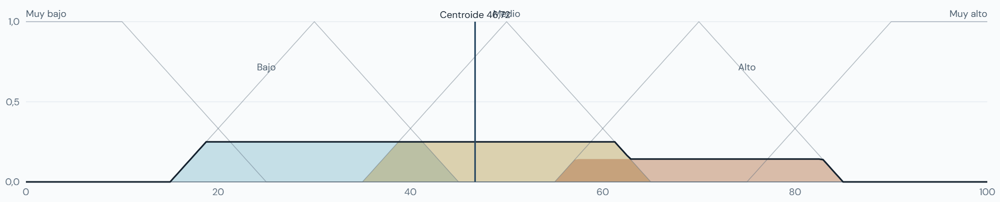

*Nota.* Elaboración propia, generada por el sistema con los parámetros finales.

## 6.3 Corrida 3

La tercera corrida conserva la potencia y la ocupación de la corrida anterior, pero cambia la hora de 12:00 a 19:00. Esto permite observar específicamente la influencia de la variable temporal (Tabla 25).

<a id="tabla-25"></a>
**Tabla 25**  
*Datos y resultado de la corrida 3*

| **Variable**         | **Valor**                    |
|----------------------|------------------------------|
| Potencia instantánea | 1900 W                       |
| Ocupantes            | 3 personas                   |
| Hora                 | 19:00                        |
| IPA obtenido         | 59,61 puntos                 |
| Interpretación       | Ahorro moderado              |
| Acción sugerida      | Apagar equipos no esenciales |

*Nota.* Elaboración propia a partir de la salida del sistema.

### Fuzzificación

Los grados correspondientes a potencia y ocupación permanecen iguales a los de la corrida 2. La diferencia se encuentra en la hora: a las 19:00, la pertenencia al conjunto Tarde llega a cero y la pertenencia a Noche es igual a 0,5 (Tabla 26).

<a id="tabla-26"></a>
**Tabla 26**  
*Grados de pertenencia de la corrida 3*

| **Variable** | **Etiqueta** | **Grado de pertenencia** |
|--------------|--------------|--------------------------|
| Potencia     | Bajo         | 0,0000                   |
|              | Medio        | 0,4286                   |
|              | Alto         | 0,1429                   |
| Ocupantes    | Pocas        | 0,0000                   |
|              | Moderadas    | 1,0000                   |
|              | Muchas       | 0,0000                   |
| Hora         | Madrugada    | 0,0000                   |
|              | Mañana       | 0,0000                   |
|              | Tarde        | 0,0000                   |
|              | Noche        | 0,5000                   |

*Nota.* Elaboración propia, a partir de la salida del sistema.

### Reglas activadas

La regla R20 genera el conjunto Medio con una activación de 0,4286, mientras que la regla R32 incorpora parcialmente el conjunto Muy alto con una activación de 0,1429 (Tabla 27). El centroide calculado es IPA = 59,61.

<a id="tabla-27"></a>
**Tabla 27**  
*Reglas activadas en la corrida 3*

| **Regla** | **Antecedentes**        | **Consecuente** | **α**  | **Cálculo**                 |
|-----------|-------------------------|-----------------|--------|-----------------------------|
| R20       | Medio, Moderadas, Noche | Medio           | 0,4286 | mín(0,4286; 1,0000; 0,5000) |
| R32       | Alto, Moderadas, Noche  | Muy alto        | 0,1429 | mín(0,1429; 1,0000; 0,5000) |

*Nota.* Elaboración propia.

### Análisis del resultado

El valor continúa dentro del intervalo de «Ahorro moderado», pero se encuentra muy próximo al límite de 60 puntos que inicia la categoría «Ahorro alto». En comparación con la corrida 2, el IPA aumenta 12,89 puntos (59,61 − 46,72), aun cuando la potencia y la cantidad de ocupantes permanecen constantes.

Este comportamiento se debe a que las reglas nocturnas asignan una prioridad superior al mismo nivel de consumo. Durante la noche se espera una reducción progresiva de determinadas cargas, por lo que un consumo de 1900 W con tres personas adquiere mayor relevancia.

La corrida demuestra que la hora no funciona únicamente como una etiqueta descriptiva, sino que modifica efectivamente la inferencia. También muestra que dos resultados pertenecientes a la misma categoría pueden expresar situaciones distintas: 46,72 representa una prioridad moderada central, mientras que 59,61 representa una prioridad moderada cercana al nivel alto.

<a id="figura-9"></a>
**Figura 9**  
*Resultado de la corrida 3 en la interfaz del sistema: 1900 W, 3 ocupantes y 19:00 h*

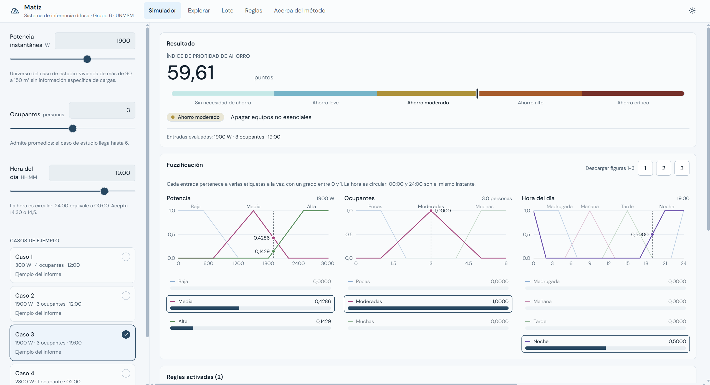

*Nota.* Elaboración propia. Captura de la interfaz web del sistema.

<a id="figura-10"></a>
**Figura 10**  
*Agregación de los conjuntos Medio y Muy alto y centroide de 59,61 puntos para la corrida 3*

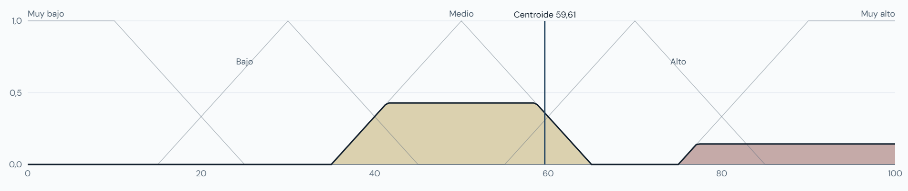

*Nota.* Elaboración propia, generada por el sistema con los parámetros finales.

## 6.4 Corrida 4

La cuarta corrida representa el escenario de mayor prioridad: una potencia elevada, una sola persona presente y una hora correspondiente a la madrugada (Tabla 28).

<a id="tabla-28"></a>
**Tabla 28**  
*Datos y resultado de la corrida 4*

| **Variable**         | **Valor**                          |
|----------------------|------------------------------------|
| Potencia instantánea | 2800 W                             |
| Ocupantes            | 1 persona                          |
| Hora                 | 02:00                              |
| IPA obtenido         | 90,71 puntos                       |
| Interpretación       | Ahorro crítico                     |
| Acción sugerida      | Desconectar cargas no prioritarias |

*Nota.* Elaboración propia a partir de la salida del sistema.

### Fuzzificación

En esta corrida las tres entradas presentan una pertenencia completa a un solo conjunto (Tabla 29).

<a id="tabla-29"></a>
**Tabla 29**  
*Grados de pertenencia de la corrida 4*

| **Variable** | **Etiqueta** | **Grado de pertenencia** |
|--------------|--------------|--------------------------|
| Potencia     | Bajo         | 0,0000                   |
|              | Medio        | 0,0000                   |
|              | Alto         | 1,0000                   |
| Ocupantes    | Pocas        | 1,0000                   |
|              | Moderadas    | 0,0000                   |
|              | Muchas       | 0,0000                   |
| Hora         | Madrugada    | 1,0000                   |
|              | Mañana       | 0,0000                   |
|              | Tarde        | 0,0000                   |
|              | Noche        | 0,0000                   |

*Nota.* Elaboración propia, a partir de la salida del sistema.

### Regla activada

Solo se activa una regla (Tabla 30). Como los tres antecedentes presentan un grado de pertenencia igual a uno, la regla R25 se activa completamente y el conjunto Muy alto se incorpora sin recorte parcial. El centroide obtenido es IPA = 90,71.

<a id="tabla-30"></a>
**Tabla 30**  
*Regla activada en la corrida 4*

| **Regla** | **Antecedentes**       | **Consecuente** | **α**  | **Cálculo**                 |
|-----------|------------------------|-----------------|--------|-----------------------------|
| R25       | Alto, Pocas, Madrugada | Muy alto        | 1,0000 | mín(1,0000; 1,0000; 1,0000) |

*Nota.* Elaboración propia.

### Análisis del resultado

El valor pertenece a la categoría «Ahorro crítico». La combinación representa una situación desfavorable: existe una demanda de 2800 W cuando solo se encuentra una persona presente y, además, son las 02:00 horas.

La cantidad reducida de ocupantes disminuye la justificación del consumo. Asimismo, durante la madrugada se espera que una mayor cantidad de equipos se encuentre apagada. La coincidencia de estos factores hace que la regla de mayor prioridad se active con intensidad completa.

El resultado no alcanza exactamente 100 puntos debido a que la defuzzificación por centroide calcula el centro geométrico del conjunto «Muy alto». El valor de 90,71 es, por tanto, el centroide de dicha función de salida y no simplemente el extremo superior de su universo.

<a id="figura-11"></a>
**Figura 11**  
*Resultado de la corrida 4 en la interfaz del sistema: 2800 W, 1 ocupante y 02:00 h*

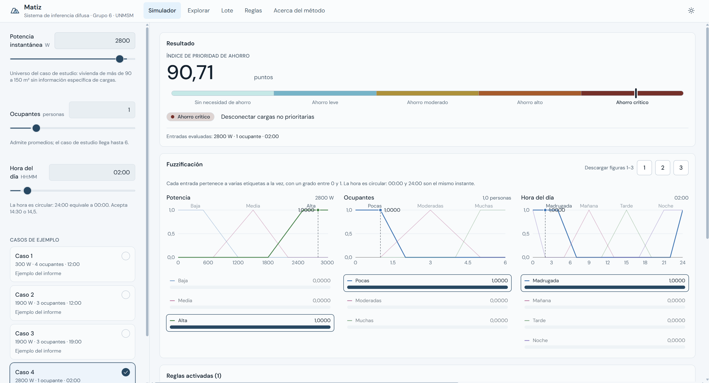

*Nota.* Elaboración propia. Captura de la interfaz web del sistema.

<a id="figura-12"></a>
**Figura 12**  
*Agregación del conjunto «Muy alto» y centroide de 90,71 puntos para la corrida 4*

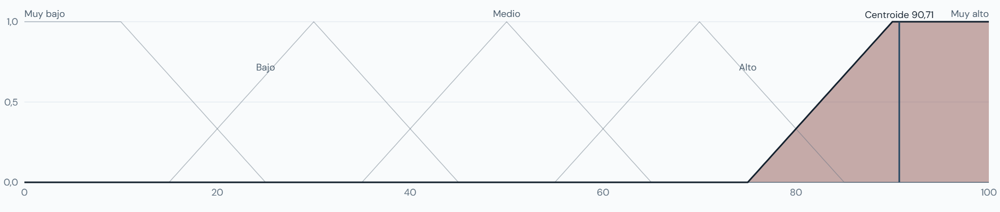

*Nota.* Elaboración propia, generada por el sistema con los parámetros finales.

## 6.5 Análisis comparativo de las corridas

Las cuatro corridas permiten comprobar que el sistema responde de manera diferente según la combinación de potencia, ocupación y hora. La primera corrida presenta la menor prioridad debido al bajo consumo y a una ocupación relativamente elevada. Las corridas 2 y 3 permiten aislar el efecto de la hora: al mantener constantes la potencia y la ocupación, el cambio de mediodía a la noche incrementa el IPA en 12,89 puntos. Finalmente, la corrida 4 combina alto consumo, baja ocupación y madrugada, produciendo la mayor prioridad. Las comparaciones se resumen en la Tabla 31.

<a id="tabla-31"></a>
**Tabla 31**  
*Comparación entre corridas*

| **Comparación**              | **Observación**                                                          |
|------------------------------|--------------------------------------------------------------------------|
| Corrida 1 frente a corrida 2 | El incremento de potencia eleva considerablemente la prioridad           |
| Corrida 2 frente a corrida 3 | La hora nocturna eleva el IPA en 12,89 puntos                            |
| Corrida 3 frente a corrida 4 | La alta potencia y la baja ocupación llevan el resultado a nivel crítico |
| Corrida 1 frente a corrida 4 | El IPA aumenta 79,12 puntos entre los escenarios extremos                |

*Nota.* Elaboración propia a partir de los resultados de la Tabla 18.

En conjunto, los resultados muestran que la salida no depende exclusivamente del consumo. La cantidad de personas permite contextualizar la demanda eléctrica y la hora modifica la importancia asignada a la misma potencia. Esto confirma el comportamiento multivariable esperado del sistema de inferencia difusa.

# 7. Conclusiones

Se diseñó e implementó un sistema de inferencia difusa de tipo Mamdani que calcula un índice de prioridad de ahorro energético (IPA), en una escala de 0 a 100 puntos, a partir de la potencia eléctrica instantánea, el número de ocupantes y la hora del día. El sistema cumple el objetivo general planteado: transforma tres magnitudes imprecisas en una recomendación gradual, con una interpretación y una acción sugerida comprensibles para el usuario de la vivienda.

Respecto de las variables, se definieron universos de discurso, etiquetas lingüísticas y funciones de pertenencia triangulares y trapezoidales, elegidas por su sencillez de interpretación y ajuste. La hora se trató como una variable circular, de modo que las 24:00 y las 00:00 son equivalentes, mediante la unión por máximo de dos componentes de un mismo conjunto. En la implementación, las variables se definen una sola vez como estructuras inmutables y son reutilizadas por el motor de inferencia, la API y el módulo de gráficas.

La base de conocimiento está formada por 36 reglas que cubren todas las combinaciones de consumo, ocupación y hora. Se construye de forma automática a partir de una tabla de decisiones compacta y se valida al importar el módulo: cantidad de reglas, identificadores únicos, etiquetas existentes, ausencia de antecedentes duplicados y cobertura completa. Además, una función heurística independiente permite auditar que la tabla programada coincide con los criterios establecidos en la sección 3. Con ello se evita que el motor opere con una base incompleta o inconsistente.

Los operadores de la inferencia se formalizaron y se implementaron de acuerdo con la configuración clásica de Mamdani: mínimo para la intersección y la implicación, máximo para la agregación y centroide para la defuzzificación. El motor se implementó como una función pura, sin estado compartido, que conserva para cada regla activa sus antecedentes, su nivel de activación y su cálculo. Esto hace que cada resultado sea trazable paso a paso, una ventaja del enfoque Mamdani frente a modelos de caja negra.

La implementación en Python resultó modular y reproducible. Las dependencias se fijaron por versión, las entradas se validan tanto en la frontera de la API como en el núcleo del sistema, y los valores fuera del dominio se rechazan con un mensaje controlado en lugar de recortarse silenciosamente. El motor puede ejecutarse desde la línea de comandos y desde una API REST, y genera las gráficas de membresía y de agregación como evidencia del procedimiento.

Las cuatro corridas del programa mostraron un comportamiento coherente con lo esperado. Un consumo bajo con varias personas presentes produjo un IPA de 11,59 puntos, sin necesidad de ahorro. Al mantener constantes 1900 W y tres ocupantes y pasar de las 12:00 a las 19:00, el IPA aumentó de 46,72 a 59,61 puntos, es decir, 12,89 puntos; esto confirma que la hora modifica la inferencia y no es una etiqueta descriptiva. El escenario de 2800 W con una sola persona a las 02:00 produjo el mayor valor, 90,71 puntos, con una única regla activada por completo. En conjunto, la salida depende de la combinación de las tres variables y no solo del consumo.

Las corridas también evidenciaron dos propiedades propias de la lógica difusa. Primero, en las zonas de solapamiento una misma entrada activa varias reglas con consecuentes distintos, y el resultado surge del centroide del conjunto agregado, no de una regla aislada. Segundo, el cambio de la salida ante variaciones de las entradas es gradual, sin los saltos bruscos que producen los umbrales fijos. Asimismo, el centroide de un conjunto extremo no alcanza el límite del universo, como ocurrió con 90,71 puntos frente a 100.

Desde la perspectiva del desarrollo sostenible, el sistema se vincula con el ODS 7, al orientar un uso más eficiente de la energía; con el ODS 12, al señalar el consumo evitable; y, de forma indirecta, con el ODS 13, porque una mayor eficiencia puede reducir las emisiones asociadas a la generación eléctrica.

El trabajo tiene limitaciones que deben tenerse presentes. La salida depende de que la potencia y la ocupación se midan de forma confiable. Los universos y las funciones de pertenencia corresponden al caso de estudio y deben recalibrarse para viviendas con otras características. El modelo se limitó a tres variables, sin condiciones ambientales ni inventario de equipos, para mantener una base de reglas completa y verificable. Finalmente, las pruebas se realizaron mediante simulación, sin mediciones reales de viviendas, y el sistema solo emite recomendaciones: no desconecta equipos ni sustituye protecciones eléctricas.

Como trabajo futuro se proponen las siguientes líneas:

- Conectar el sistema con sensores de potencia y de presencia, y con un microcontrolador, para evaluarlo en tiempo real.

- Validar y ajustar los universos y las reglas con mediciones reales de consumo de distintas viviendas.

- Ampliar el modelo con nuevas variables, como la temperatura o el inventario de equipos, manteniendo la verificación de la base de reglas.

- Comparar el enfoque Mamdani con un modelo de tipo Takagi-Sugeno en términos de precisión e interpretabilidad.

# 8. Referencias

Ain, Q.-u., Iqbal, S., Khan, S. A., Malik, A. W., Ahmad, I., & Javaid, N. (2018). IoT operating system based fuzzy inference system for home energy management system in smart buildings. *Sensors, 18*(9), 2802. https://doi.org/10.3390/s18092802

Bissey, S., Jacques, S., & Le Bunetel, J.-C. (2017). The fuzzy logic method to efficiently optimize electricity consumption in individual housing. *Energies, 10*(11), 1701. https://doi.org/10.3390/en10111701

Ciabattoni, L., Grisostomi, M., Ippoliti, G., & Longhi, S. (2013). A fuzzy logic tool for household electrical consumption modeling. En *IECON 2013—39th Annual Conference of the IEEE Industrial Electronics Society* (pp. 8022–8027). IEEE. https://doi.org/10.1109/IECON.2013.6700474

González, A., De la Cruz, R., Salazar, C., & Marino, D. (2018). *Informe de resultados: Consumo y usos de electricidad. Encuesta Residencial de Consumo y Usos de Energía 2018*. Gerencia de Políticas y Análisis Económico, Osinergmin. https://www.osinergmin.gob.pe/seccion/centro_documental/Institucional/Estudios_Economicos/ERCUE/ERCUE-Electricidad-Informe-2018-GPAE-OS.pdf

Harris, C. R., Millman, K. J., van der Walt, S. J., Gommers, R., Virtanen, P., Cournapeau, D., Wieser, E., Taylor, J., Berg, S., Smith, N. J., Kern, R., Picus, M., Hoyer, S., van Kerkwijk, M. H., Brett, M., Haldane, A., Fernández del Río, J., Wiebe, M., Peterson, P., … Oliphant, T. E. (2020). Array programming with NumPy. *Nature, 585*(7825), 357–362. https://doi.org/10.1038/s41586-020-2649-2

Instituto Nacional de Estadística e Informática. (2018). *Perú: Perfil sociodemográfico. Informe nacional. Censos Nacionales 2017*. https://www.inei.gob.pe/media/MenuRecursivo/publicaciones_digitales/Est/Lib1539/cap06.pdf

International Energy Agency. (2001). *Things that go blip in the night: Standby power and how to limit it*. https://www.iea.org/reports/things-that-go-blip-in-the-night

Jang, J.-S. R., Sun, C.-T., & Mizutani, E. (1997). *Neuro-fuzzy and soft computing: A computational approach to learning and machine intelligence*. Prentice Hall.

Javaid, S., Javaid, N., Iqbal, S., & Mughal, M. J. (2017). Controlling energy consumption with the world-wide adaptive thermostat using fuzzy inference system in smart grid. En *2017 International Conference on Information and Communication Technology Convergence (ICTC)* (pp. 66–71). IEEE. https://doi.org/10.1109/ICTC.2017.8190944

Kavousian, A., Rajagopal, R., & Fischer, M. (2013). Determinants of residential electricity consumption: Using smart meter data to examine the effect of climate, building characteristics, appliance stock, and occupants’ behavior. *Energy, 55*, 184–194. https://doi.org/10.1016/j.energy.2013.03.086

Keshtkar, A., Arzanpour, S., Keshtkar, F., & Ahmadi, P. (2015). Smart residential load reduction via fuzzy logic, wireless sensors, and smart grid incentives. *Energy and Buildings, 104*, 165–180. https://doi.org/10.1016/j.enbuild.2015.06.068

Kontogiannis, D., Bargiotas, D., & Daskalopulu, A. (2021). Fuzzy control system for smart energy management in residential buildings based on environmental data. *Energies, 14*(3), 752. https://doi.org/10.3390/en14030752

Mamdani, E. H., & Assilian, S. (1975). An experiment in linguistic synthesis with a fuzzy logic controller. *International Journal of Man-Machine Studies, 7*(1), 1–13. https://doi.org/10.1016/S0020-7373(75)80002-2

Ministerio de Energía y Minas. (2006). *Código Nacional de Electricidad: Utilización* (Resolución Ministerial N.° 0037-2006-MEM). https://www.gob.pe/institucion/minem/normas-legales/108855-0037-2006-mem

Naciones Unidas. (2015). *Transformar nuestro mundo: La Agenda 2030 para el Desarrollo Sostenible* (Resolución A/RES/70/1). https://sdgs.un.org/es/2030agenda

Organismo Supervisor de la Inversión en Energía y Minería. (s. f.). *¿Quieres saber cuánto consumen tus artefactos?* https://www.osinergmin.gob.pe/seccion/centro_documental/Folleteria/5%20Quieres%20saber%20cuanto%20consumen%20tus%20artefactos.pdf

Organismo Supervisor de la Inversión en Energía y Minería. (2013). *Resolución de Consejo Directivo N.° 206-2013-OS/CD*. https://www.osinergmin.gob.pe/Resoluciones/pdf/2013/R_OSINERGMIN_No.206-2013-OS-CD.pdf

Organismo Supervisor de la Inversión en Energía y Minería. (2023). *Resolución de Consejo Directivo N.° 116-2023-OS/CD*. https://www.osinergmin.gob.pe/Resoluciones/pdf/2023/Osinergmin-116-2023-OS-CD.pdf

Organismo Supervisor de la Inversión en Energía y Minería. (2024). Modificación de la norma Opciones Tarifarias y Condiciones de Aplicación de las Tarifas a Usuario Final: Opción tarifaria BT5-I. *El Informativo*. https://www2.osinergmin.gob.pe/publicacionesgrt/pdf/Informativo/El%20Informativo%20-%20Abril%202024%20v4.pdf

Richardson, I., Thomson, M., Infield, D., & Clifford, C. (2010). Domestic electricity use: A high-resolution energy demand model. *Energy and Buildings, 42*(10), 1878–1887. https://doi.org/10.1016/j.enbuild.2010.05.023

Ross, T. J. (2010). *Fuzzy logic with engineering applications* (3.ª ed.). John Wiley & Sons.

Şahin, M. Ç., & Aydinalp Koksal, M. (2014). Standby electricity consumption and saving potentials of Turkish households. *Applied Energy, 114*, 531–538. https://doi.org/10.1016/j.apenergy.2013.10.021

Shareef, H., Ahmed, M. S., Mohamed, A., & Al Hassan, E. (2018). Review on home energy management system considering demand responses, smart technologies, and intelligent controllers. *IEEE Access, 6*, 24498–24509. https://doi.org/10.1109/ACCESS.2018.2831917

Takagi, T., & Sugeno, M. (1985). Fuzzy identification of systems and its applications to modeling and control. *IEEE Transactions on Systems, Man, and Cybernetics, SMC-15*(1), 116–132. https://doi.org/10.1109/TSMC.1985.6313399

Van Leekwijck, W., & Kerre, E. E. (1999). Defuzzification: Criteria and classification. *Fuzzy Sets and Systems, 108*(2), 159–178. https://doi.org/10.1016/S0165-0114(97)00337-0

Zadeh, L. A. (1965). Fuzzy sets. *Information and Control, 8*(3), 338–353. https://doi.org/10.1016/S0019-9958(65)90241-X

Zhou, B., Li, W., Chan, K. W., Cao, Y., Kuang, Y., Liu, X., & Wang, X. (2016). Smart home energy management systems: Concept, configurations, and scheduling strategies. *Renewable and Sustainable Energy Reviews, 61*, 30–40. https://doi.org/10.1016/j.rser.2016.03.047

Zimmermann, H.-J. (2001). *Fuzzy set theory—and its applications* (4.ª ed.). Springer. https://doi.org/10.1007/978-94-010-0646-0
